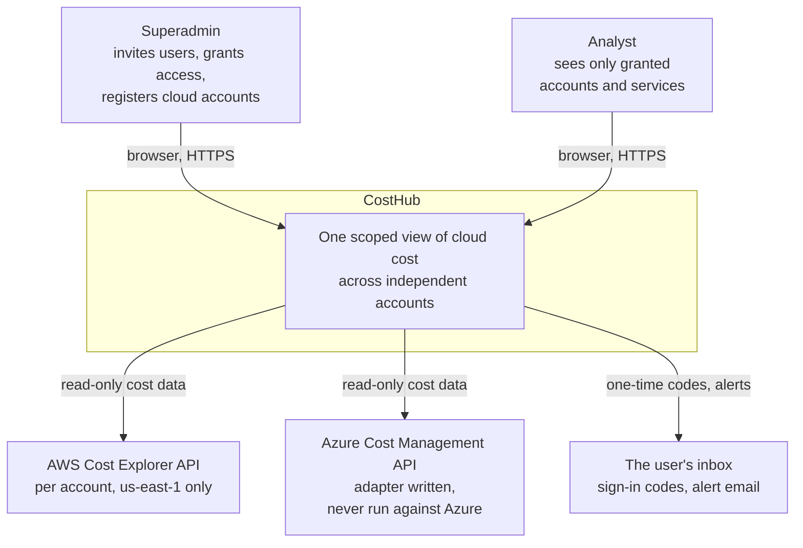
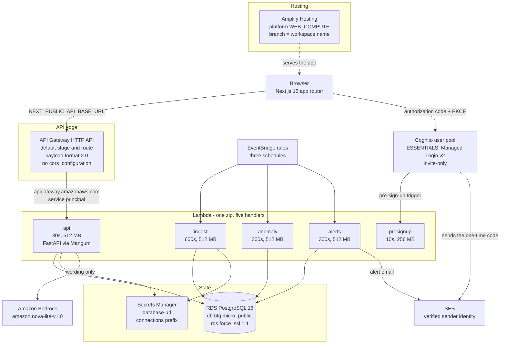
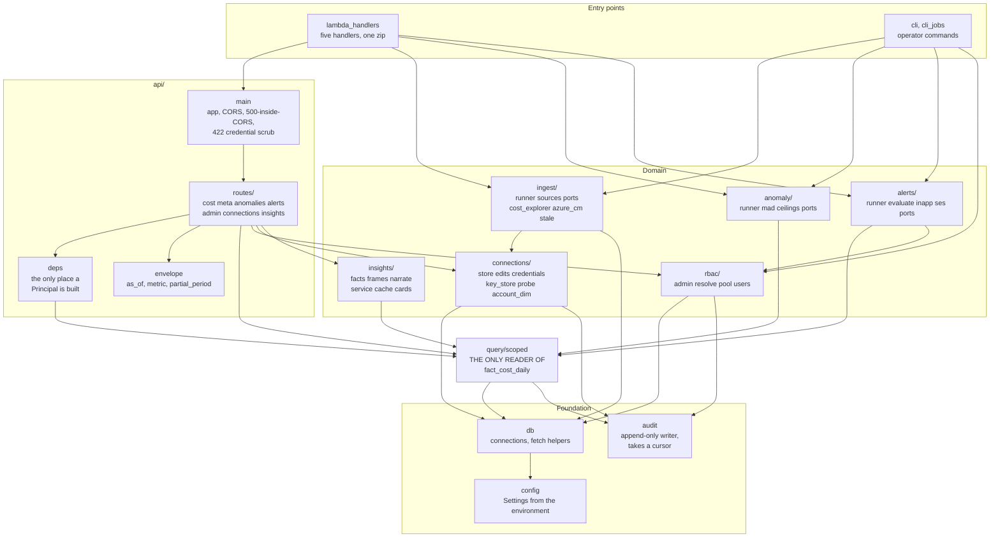
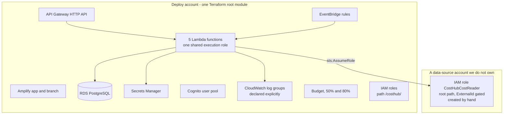

# Architecture

Three levels, in the order they are useful: who the system serves, what it
is deployed as, and what the code is made of. Then the decisions behind the
shape, and what is deliberately absent.

Everything below is drawn from `terraform/` and `backend/costhub/` as they
stand. Behavioural flows are in [04-data-flow.md](04-data-flow.md); the
sign-in sequence is in [07-security-rbac.md](07-security-rbac.md); a
connection's life is in
[17-connection-lifecycle.md](17-connection-lifecycle.md).

---

## Level 1 — Context

Who uses it, and what it talks to. No internals.



Two things this picture is making explicit.

**Deployment target and data source are different concerns.** The system is
deployed once, into one AWS account, and reads other accounts read-only. It
never needs deploy rights anywhere else — only a read-only role, or a
read-only key, in each account it reads.

**There is no Google Cloud edge.** `ingest/sources.py` has adapters for
`aws` and `azure` only, so a GCP connection raises `NoAdapter`. See
[What is deliberately absent](#what-is-deliberately-absent).

---

## Level 2 — Containers

What is actually deployed. Every box below is a Terraform resource in
`terraform/`.



### Which Lambda is on which schedule

From `terraform/variables.tf`; overridable per environment.

| Function | Trigger | Schedule, UTC | Why then |
|---|---|---|---|
| `api` | API Gateway HTTP API | on request | — |
| `ingest` | EventBridge rule `costhub-<env>-ingest` | `cron(0 6 * * ? *)` | yesterday's cost has usually landed by 06:00 |
| `anomaly` | EventBridge rule `costhub-<env>-anomaly` | `cron(30 6 * * ? *)` | detect on what ingest just wrote |
| `alerts` | EventBridge rule `costhub-<env>-alerts` | `cron(0 7 * * ? *)` | alert on what was detected |
| `presignup` | Cognito `pre_sign_up` | on sign-up | domain gate |

Spread across the hour rather than chained, so each is independently
retryable. A failure at 06:00 does not stop 06:30 running on yesterday's
data.

### Two edge facts that are easy to get wrong

**There is no Lambda Function URL, and reintroducing one will not work.**
This account blocks anonymous Lambda invocation: a Function URL with a
textbook-correct public resource policy returned `403
AccessDeniedException` to every request, with no invocation recorded in
CloudWatch, and a hand-built throwaway function URL did the same. API
Gateway sidesteps it because the invocation is no longer anonymous — API
Gateway calls the function as the `apigateway.amazonaws.com` service
principal, authorised by `aws_lambda_permission.apigateway` scoped to that
API's execution ARN. The full evidence is in the header comment of
`terraform/apigateway.tf`.

Payload format 2.0 is identical to what a Function URL sends, so Mangum and
the application needed no change. What the HTTP API adds that the URL could
not is throttling — `throttling_burst_limit = 20` and
`throttling_rate_limit = 50` on the default stage — which matters because
the account's Lambda concurrency ceiling is 10.

**CORS has exactly one owner: the FastAPI app.** The HTTP API deliberately
declares no `cors_configuration`. Two layers each adding
`Access-Control-Allow-Origin` produces a duplicated header that browsers
reject outright — a failure that reads as "CORS is broken" while both
layers are individually correct. With no CORS block on the gateway,
`OPTIONS` passes through and `CORSMiddleware` in `api/main.py` answers the
preflight. Its allowed origins come from the `CORS_ORIGINS` Lambda
environment variable, built in `terraform/lambda.tf` from the Amplify
branch domain plus `http://localhost:3000` when `allow_local_frontend` is
true.

---

## Level 3 — Components

Inside `backend/costhub/`. Arrows point the way the dependency points.



### The one direction that is a rule, not a preference

Every reader of cost data points at `query/scoped`, and `query/scoped`
points at nothing above it. `anomaly`, `alerts`, `insights` and the API all
read facts **through** it — none of them queries `fact_cost_daily`.

That is enforced, not asserted. `backend/tests/test_invariant.py` parses
every module in the package and fails the build if a SQL string literal
outside the allowlist selects from the fact table. The allowlist is two
entries: `query/scoped.py`, which reads, and `ingest/runner.py`, which
writes. The same file also fails the build on a module that constructs its
own `Principal(role="superadmin")`, because that replaces the grant
predicate wholesale; `scoped.system_principal()` is the one sanctioned way
for a background job to see every account.

The invariant had already silently become false twice — `anomaly/runner.py`
and `cli.py` both grew direct reads while five documents asserted it held.

### What each component owns

| Component | Owns | Does not |
|---|---|---|
| `api/deps` | constructing a `Principal` from a verified JWT | decide which rows it may see |
| `query/scoped` | the grant predicate, every fact read, the bypass audit | know anything about HTTP |
| `rbac/` | users, grants, Cognito pool writes | read cost data |
| `connections/` | `cloud_connections` rows, credential resolution, the probe | fetch cost |
| `ingest/` | fetching, upserting, `ingest_runs` lineage | authorisation |
| `anomaly/` | scoring a series, persisting findings | fetching the series |
| `alerts/` | rule evaluation, the grant re-check, delivery | computing cost |
| `insights/` | computing figures and writing candidate sentences | letting a model compute anything |
| `audit` | one append-only row, inside the caller's transaction | its own connection |

---

## Why this shape

| Decision | Reason |
|---|---|
| Lambda, not EC2 or ECS | Every job is a few seconds, once or twice a day. Compute idles essentially all of the time. |
| One zip, five handlers | The code is small, and a single artifact means one build step and no chance of the API drifting from the jobs. |
| Zip packages, not container images | No Docker on the dev machine. |
| API Gateway HTTP API, not a Function URL | The account refuses anonymous Lambda invocation. The gateway also gives throttling, which the URL could not. |
| No VPC | The jobs need the internet, for Cost Explorer, **and** the database. A VPC would require a NAT Gateway at roughly $32/month, more than the rest of the stack combined. Public Postgres with enforced TLS avoids it; hardening is [deferred, not missed](10-todo-future.md). |
| Postgres, not DynamoDB | The query is "sum cost grouped by service for these accounts over this range", and the grant filter is a join. DynamoDB has neither, so authorisation would move into application code and break NFR-1. |
| Postgres, not Athena | No transactions and no `UPDATE`, so no acknowledging a finding or revoking a grant; a 1-3s floor and a per-query charge on a clicked dashboard. Athena is right for a deep layer, not for app state. |
| Amplify Hosting, not raw S3 and CloudFront | Amplify *is* S3 plus CloudFront plus a build pipeline. A free HTTPS URL and atomic deploys, with nothing to wire. |
| Next.js on `WEB_COMPUTE` | The frontend is Next 15 app router, which needs server rendering. Amplify's `WEB` platform is static-only and serves a broken tree. |
| Terraform workspace as the environment | State and environment cannot disagree, and `destroy` on `dev` physically cannot reach `main`. |

---

## Two data layers

The common mistake is choosing one store for both.

| Layer | Volume | Access pattern | Store | State |
|---|---|---|---|---|
| **App layer** — daily rollup, grants, rules, findings, audit | tens of thousands of rows per month | join, aggregate, update | PostgreSQL | built |
| **Deep layer** — FOCUS or CUR line items | 10⁸+ rows | scan, drill to resource | S3 and Athena | deferred, TODO-15 |

The daily rollup is what makes a sub-second dashboard and a one-line grant
join possible at the same time.

---

## Deployment



Everything in the left box is created and destroyed as a unit. The right
box is **one role, created once by hand** by whoever holds IAM access in
that account — deliberately outside this Terraform, because we do not own
the account and the role must survive our teardown. An account where nobody
will create that role uses `credential_mode = "secret"` instead; see
[17-connection-lifecycle.md](17-connection-lifecycle.md).

The Lambda execution role is **shared by all five functions**, which is
worth knowing before reasoning about blast radius: the Bedrock grant and
the Secrets Manager write grant are held by the job functions too, even
though only the API uses them.

### Environments

Three are declared; **one exists**. `dev`, in a single AWS account,
us-east-1. `staging` and `main` are supported by the code and have never
been applied.

| `ENV` | Database | Frontend | Jobs |
|---|---|---|---|
| `dev` | RDS `costhub-dev-db` | Amplify `dev` branch | EventBridge |
| `staging` | RDS | Amplify `staging` branch | EventBridge |
| `main` | RDS | Amplify `main` branch | EventBridge |

**Every environment uses RDS.** Neon is not an environment — it is the
local sandbox that `backend/.env` points at, full of `dev_seed` rows. See
[15-mock-vs-live.md](15-mock-vs-live.md) and CONTEXT.md trap 8; conflating
the two has already caused someone to read seeded rows as live state.

```bash
./do.sh up dev        # build, apply, branding, migrate, outputs
./do.sh outputs dev   # re-read live values into frontend/.env.local
```

Full design in
[13-environments-and-teardown.md](13-environments-and-teardown.md).

---

## Technology choices

| Concern | Choice | Note |
|---|---|---|
| Language | Python 3.11 | the Lambda runtime |
| API | FastAPI behind an API Gateway HTTP API, via Mangum | not a Function URL |
| DB driver | `psycopg` 3 and plain SQL | no ORM; the grant predicate stays reviewable |
| Migrations | numbered `.sql` files plus a small runner | 001-008 applied; no Alembic |
| Tests | pytest | including `test_invariant.py`, which enforces architecture |
| Frontend | Next.js 15 app router, React 19, Tailwind, Recharts | [06-frontend.md](06-frontend.md) |
| IaC | Terraform `>= 1.5`, single root module, **local state** | one machine, no lock server |
| Auth | Cognito ESSENTIALS tier, Managed Login v2 | ESSENTIALS is required for passwordless |
| Narration | Amazon Bedrock, `amazon.nova-lite-v1:0` | wording only; [16-insights-api.md](16-insights-api.md) |

---

## What is deliberately absent

Named here so "we knew and deferred" is distinguishable from "we missed
it".

- **No GCP adapter.** `ingest/sources.py` `ADAPTERS` is `{aws, azure}`, so
  a GCP connection raises `NoAdapter` and imports nothing. The mock estate
  shows three Google Cloud accounts and the connect dialog offers a GCP
  project-id field, so this is the one place the demo promises more than
  exists. It is a missing module rather than an impossible one — one entry
  in `ADAPTERS` and one new file. Owner's call: write it, or say on screen
  that Google Cloud is a roadmap item. TODO-16.
- **Azure is written and has never spoken to Azure.** `azure_cm.py` is
  unit-tested against recorded response shapes through a mock HTTP client,
  so the request shape and pagination are real; the live path is not. The
  connection probe returns `stage="unsupported"` for a non-AWS provider
  rather than guessing.
- No VPC, NAT Gateway or private subnets — TODO-1. The database is publicly
  reachable with TLS enforced and a generated password.
- No caching tier. The rollup is fast enough at this volume.
- No queue between ingest and store. Single writer, low volume.
- No multi-region and no HA.
- No SNS topic. One existed as a landing point for AWS Cost Anomaly
  Detection findings; nothing ever published to it, so it was two
  resources, a dead IAM action and a dead environment variable supporting a
  feature that does not exist. TODO-17 creates it when something needs it.
- No currency conversion. Every account in scope bills in USD (NFR-7b).
- No synthetic data in the database. The mock estate lives entirely in the
  frontend and never becomes a row — see
  [15-mock-vs-live.md](15-mock-vs-live.md).
