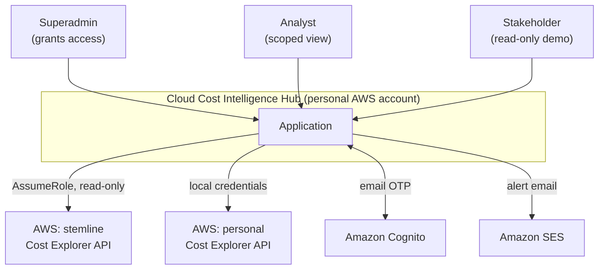
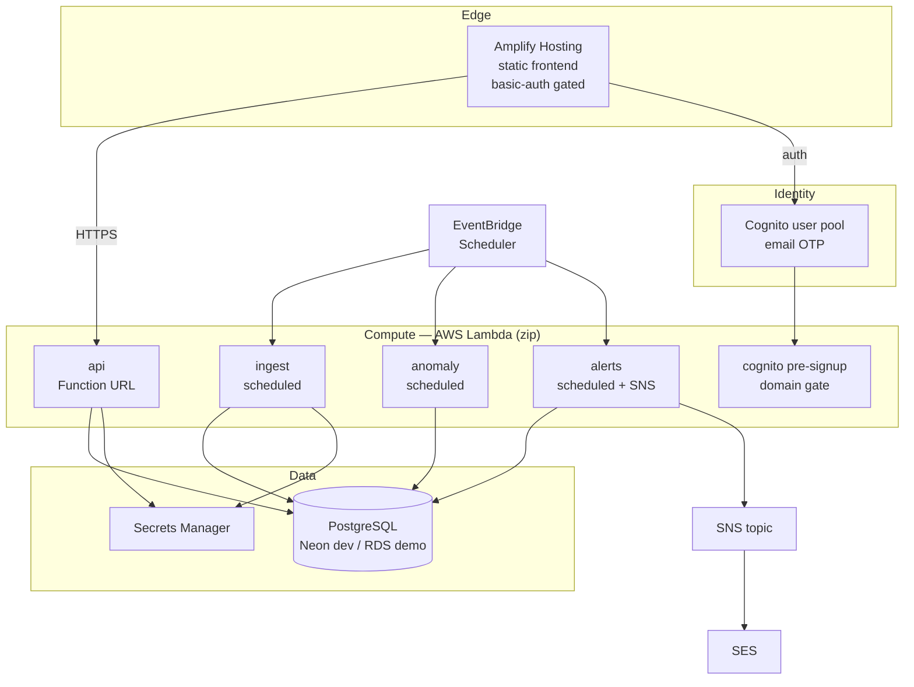
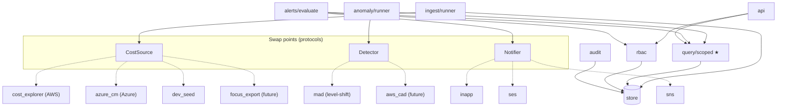
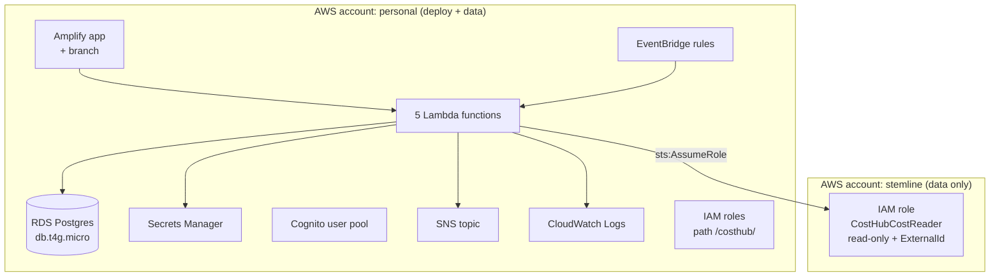

# Architecture

## 1. Context diagram

Who and what the system touches.



Key separation: **deployment target and data source are different concerns.**
The app is deployed once, in the personal account, and reaches into other
accounts read-only. We never need deploy rights in stemline.

---

## 2. High-level architecture



### Why this shape

| Decision | Reason |
|---|---|
| Lambda, not EC2/ECS | Every job is a few seconds, once or twice a day. Compute idles 99.99% of the time. Also no deploy rights for ECS/App Runner/Lightsail in the work account. |
| Zip packages, not container images | No Docker on the dev machine. The AWS-managed `AWSSDKPandas-Python312` layer supplies pandas/numpy. |
| No VPC | The ingest Lambda needs internet (Cost Explorer API) **and** the database. Putting Lambda in a VPC would require a NAT Gateway at ~$32/month — larger than the rest of the stack combined. Public Postgres with TLS avoids it. Hardening is [deferred, not missed](10-todo-future.md). |
| Postgres, not DynamoDB | Queries are "sum cost grouped by service for these accounts over this range, compared to last month", and the grant filter is a join. DynamoDB has neither aggregation nor joins — authorization would move into application code, breaking NFR-1. |
| Postgres, not Athena | No transactions, no `UPDATE` (so no acknowledging an alert or revoking a grant), 1–3s query floor, per-query cost on a clicked dashboard. Athena is right for the deep layer, not app state. |
| Amplify, not raw S3+CloudFront | Amplify *is* S3+CloudFront plus a build pipeline. It gives a free HTTPS URL, atomic deploys, and per-branch password protection — the last one is how stakeholders get access without waiting for auth to be finished. |

---

## 3. Two data layers

The common mistake is choosing one store. The answer differs per layer.

| Layer | Volume | Access pattern | Store | Status |
|---|---|---|---|---|
| **App layer** — rollup, grants, rules, audit | ~10⁴ rows/month | join, aggregate, update | PostgreSQL | built |
| **Deep layer** — FOCUS/CUR line items | 10⁸+ rows | scan, drill to resource | S3 + Athena | deferred |

The daily rollup is what makes sub-second dashboards and a trivially simple
grant join possible at the same time.

---

## 4. Component architecture (backend)



`★` marks the single authorization point. Note that `anomaly`, `alerts` and
`api` all read facts **through** `query/scoped`, never directly — that is
what makes NFR-1 testable rather than aspirational.

---

## 5. Deployment architecture



All of the left box is one Terraform root module, created and destroyed as a
unit. The right box is **one role, created once by hand** by whoever holds
IAM access in stemline — it is deliberately outside our Terraform because we
do not own that account.

### Environments

Three, selected by **one switch** — `ENV` — which in Terraform is the
workspace itself, so state and environment cannot disagree.

| `ENV` | Database | Frontend | Jobs |
|---|---|---|---|
| `dev` | Neon free tier | Amplify `dev` branch | invoked manually |
| `staging` | RDS `db.t4g.micro` | Amplify `staging` branch | EventBridge |
| `main` | RDS `db.t4g.micro` | Amplify `main` branch | EventBridge |

Every resource name, log group, secret path and tag derives from `ENV`.
Per-environment values live in exactly one file each: `terraform/env/<env>.tfvars`.

Identical code throughout; only `DATABASE_URL` and the job trigger differ
(NFR-21).

```bash
terraform workspace select dev
terraform apply -var-file=env/dev.tfvars
```

Because each workspace holds its own state, `terraform destroy` on `dev`
cannot touch `main`. Teardown is a single command that backs up, verifies the
backup, destroys, then proves completion with a tag sweep:

```bash
./do.sh teardown dev
```

Full design in [13-environments-and-teardown.md](13-environments-and-teardown.md).

---

## 6. Technology choices

| Concern | Choice | Note |
|---|---|---|
| Language | Python 3.11 | 3.14 is too new for some wheels |
| API | FastAPI on Lambda Function URL | no API Gateway; fewer moving parts |
| DB driver | `psycopg` 3 + plain SQL | no ORM — the grant predicate stays reviewable |
| Migrations | numbered `.sql` + 30-line runner | no Alembic; schema is small |
| Tests | pytest | |
| Frontend | React + Recharts | see [06-frontend.md](06-frontend.md) |
| IaC | Terraform 1.15, single root module, local state | |
| Auth | Cognito, Essentials tier, Managed Login | Essentials required for passwordless; classic Hosted UI does not support it |

---

## 7. What is deliberately absent

Named here so that "we knew and deferred" is distinguishable from "we missed it".

- No VPC, NAT Gateway or private subnets — [TODO-1](10-todo-future.md)
- No API Gateway (Function URL instead) — no throttling layer yet
- No caching tier — the rollup is fast enough at this volume
- No queue between ingest and store — single-writer, low volume
- No multi-region, no HA — a 10-day demo
- No GCP ingestion — architecture ready, no project available
- **Azure ingestion is built but unverified** — the adapter exists; it needs a
  subscription and a Cost Management Reader role. Built ahead of access so
  the request is concrete rather than speculative.
- No currency conversion — every account in scope bills in **USD** (NFR-7b)
- No synthetic data in the database — multi-account and Azure views in the
  demo are **frontend fixtures**, removable without touching the backend
