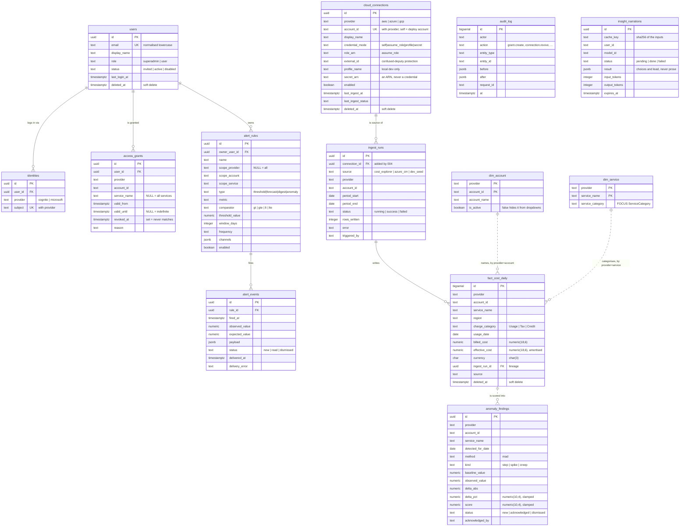

# Data model

**14 tables** in one PostgreSQL database. Migrations in
`backend/migrations/`, applied once each by `python -m costhub.migrate`.

| # | Table | Migration | Purpose |
|---|---|---|---|
| 1 | `schema_migrations` | 001 | which files have run |
| 2 | `users` | 001 | one row per person |
| 3 | `identities` | 001 | login methods to user |
| 4 | `access_grants` | 001 | **who may see what** |
| 5 | `audit_log` | 001 | append-only change history |
| 6 | `ingest_runs` | 002 | lineage for every fact write |
| 7 | `dim_account` | 002 | account names |
| 8 | `dim_service` | 002 | service names, FOCUS category |
| 9 | `fact_cost_daily` | 002 | **the daily rollup** |
| 10 | `alert_rules` | 003 | rule definitions |
| 11 | `alert_events` | 003 | firing history |
| 12 | `anomaly_findings` | 003 | detections |
| 13 | `cloud_connections` | 004 | registered cloud accounts |
| 14 | `insight_narrations` | 008 | the narration cache and call ledger |

Two more migrations change existing objects rather than adding tables: 005
makes `audit_log` append-only, 006 seeds the superadmin row, and 007
reclassifies `charge_category` on rows written before the Cost Explorer
adapter derived it.

All of 001-008 are applied. Earlier versions of this page described 004 as
"pending"; it is not.

---

## ERD

The core tables, drawn from the migration files. Columns shown are the keys
and the ones that carry meaning — every table also has the audit columns
described below.



### Two relationships that are not foreign keys

The dashed lines above are real relationships with **no FK constraint**,
and that is deliberate rather than an omission.

`fact_cost_daily` joins `dim_account` and `dim_service` on
`(provider, account_id)` and `(provider, service_name)`. The dimensions are
upserted by the ingest alongside the facts, so a constraint would order the
two writes and buy nothing — and a fact row whose dimension row is missing
is still a correct fact.

`anomaly_findings` carries `(provider, account_id, service_name)` and no
reference to a fact row, because a finding is about a *series* over a
window, not about one row.

`fact_cost_daily.ingest_run_id` **is** a real foreign key, because that one
is lineage: for a machine-written row it is the audit trail.

---

## Audit conventions

### Audit columns

```sql
created_at timestamptz NOT NULL DEFAULT now(),
created_by text        NOT NULL,
updated_at timestamptz NOT NULL DEFAULT now(),
updated_by text,
deleted_at timestamptz,          -- soft delete; no hard DELETE
deleted_by text,
revision   integer     NOT NULL DEFAULT 1
```

Not every table carries all of them, and the exceptions are reasoned.
`schema_migrations` and `audit_log` have none at all — one is bookkeeping,
the other *is* the trail. `ingest_runs`, both dimensions, `alert_events`
and `anomaly_findings` omit `deleted_at` / `deleted_by` because nothing
soft-deletes them. `insight_narrations` carries only `created_at` and
`expires_at`, because it is a cache with a TTL, not a record of a human
action. This section used to say "no exceptions", which was false for more
than half the tables.

**A distinction worth being deliberate about.** For human-edited tables
`created_by` is a user email. For machine-written fact rows it is the
ingest job identity, and the meaningful trail is **lineage** — so
`fact_cost_daily` additionally carries `ingest_run_id` and `source`. Same
columns, different semantics; both are needed.

### Audit log — append-only

Separate from the columns above. Records *what changed*, with `before` and
`after` as JSONB. Only access-affecting changes go here: grants, users,
connections, superadmin bypasses, and one row per detection or ingest run.

It is written **inside the caller's transaction** — `audit.log()` takes a
cursor, not a connection — because an audit log that can disagree with the
data is worse than none.

Append-only by **statement trigger**, not by convention, and not by grants,
which was claimed here for a long time and never existed:

```sql
-- migration 005: BEFORE UPDATE/DELETE statement triggers that RAISE.
-- The accompanying REVOKE is belt-and-braces only: Postgres grants
-- nothing to PUBLIC by default, and the app connects as the table owner,
-- which keeps implicit rights regardless. The triggers are the control.
CREATE TRIGGER audit_log_no_update BEFORE UPDATE ON audit_log
  FOR EACH STATEMENT EXECUTE FUNCTION audit_log_is_append_only();
```

`TRUNCATE` is **not** covered — the test suite truncates `audit_log`
between tests, which is the proof. A production role should not hold
TRUNCATE on it.

---

## `access_grants` — the important one

| Column | Meaning |
|---|---|
| `service_name = NULL` | all services in that account |
| `valid_until = NULL` | indefinite |
| `revoked_at NOT NULL` | revoked; never matches, never deleted |

```sql
CHECK (valid_until IS NULL OR valid_until > valid_from)

CREATE INDEX idx_grants_lookup
  ON access_grants (user_id, provider, account_id)
  WHERE revoked_at IS NULL AND deleted_at IS NULL;
```

Grants reference `users.id`, **never the IdP subject**. That is what makes
adding Microsoft OAuth later an insert into `identities` rather than a
migration of every grant.

`principal_type` is intentionally *not* present yet. Per-user grants stop
scaling around 25-30 people; adding group support means one column plus a
branch in the predicate. TODO-22.

---

## `fact_cost_daily` — the rollup

**Grain:** `date × provider × account × service × region × charge_category`

Column names follow FOCUS (`BilledCost` → `billed_cost`, `EffectiveCost` →
`effective_cost`, `ChargeCategory` → `charge_category`, `ServiceName` →
`service_name`) so a FOCUS-export adapter needs no translation layer
(NFR-20).

### Four decisions embedded here

**Both cost measures stored.** `billed_cost` reconciles to the invoice;
`effective_cost` is amortised and is what comparisons should use. A chart
that does not state which it shows will be disputed.

**`numeric(18,6)`, never float.** This is money (NFR-7).

**Natural-key uniqueness** makes re-ingestion idempotent:

```sql
UNIQUE (provider, account_id, service_name, region,
        charge_category, usage_date, currency)
```

Cost data is restated as it finalises, so recent days get re-fetched
routinely. Without this, every re-run duplicates. Writes use `ON CONFLICT
... DO UPDATE`.

**`charge_category` is part of the key**, so `Tax` and `Credit` rows stay
separable — they must be excluded from per-service comparisons (FR-23) but
still sum to the invoice. Note the limitation in
[05-backend.md](05-backend.md): Cost Explorer returns inline credits as
*negative amounts on the real service name*, so those are still labelled
`Usage`.

### Indexes are partial on the soft delete

```sql
CREATE INDEX idx_fact_scope
  ON fact_cost_daily (provider, account_id, usage_date)
  WHERE deleted_at IS NULL;

CREATE INDEX idx_fact_service
  ON fact_cost_daily (provider, account_id, service_name, usage_date)
  WHERE deleted_at IS NULL;
```

Both match the shape `query/scoped._where` builds: `deleted_at IS NULL`
first, then the date range, then the grant predicate.

### Volume

A handful of accounts × roughly 30 services × a few regions × 30 days is
tens of thousands of rows a month. Three years would still be under a
million. This is a small database; the design is for clarity, not scale.

### No synthetic data in this table

`source` records lineage (`cost_explorer` | `azure_cm` | `dev_seed`), not a
display mode. The demo's multi-account and multi-cloud views are **frontend
mock data** and never become rows here.

That is deliberate twice over. Storing them would collide with real rows on
the natural key above — `source` is not part of it — and would create a
path by which synthetic data could be served as real. Keeping them in the
frontend means removal is deleting a directory rather than a migration plus
a data cleanup.

`dev_seed` is the one exception, and it only ever runs against a local
development database. See [15-mock-vs-live.md](15-mock-vs-live.md).

---

## `cloud_connections`

Backs the connect-account form (FR-11). The four credential modes, the
state machine, and what `secret` actually stores are all in
[17-connection-lifecycle.md](17-connection-lifecycle.md) — this is the
schema only.

| Column | Note |
|---|---|
| `provider`, `account_id` | unique together; `self` means the deploy account |
| `display_name` | the label shown in the UI |
| `credential_mode` | `CHECK (credential_mode IN ('self','assume_role','profile','secret'))` |
| `role_arn` | a second `CHECK` requires it when the mode is `assume_role` |
| `external_id` | confused-deputy protection; returned in full to a superadmin |
| `profile_name` | local development only — **cannot work in Lambda** |
| `secret_arn` | a Secrets Manager ARN. Never a credential value |
| `enabled` | disable without losing history (FR-13) |
| `last_ingest_at`, `last_ingest_status` | surfaced on the connections screen |
| `deleted_at` | soft delete; the row stays so `audit_log` keeps resolving |

```sql
CREATE INDEX idx_connections_enabled
  ON cloud_connections (provider, account_id)
  WHERE enabled AND deleted_at IS NULL;
```

**No credential is stored in this database** (FR-12), and that holds for
all four modes. For `self` and `assume_role` there is nothing to store. For
`profile` it is a profile *name*. For `secret` the column holds an ARN,
read at call time.

---

## `insight_narrations`

The narration cache and, in the same rows, the call ledger. One row per
`(cache_key, user_id)` attempt.

Two things make it a ledger rather than just a cache. The row is written
`pending` **before** the Bedrock call, so it proves the ledger is writable
before any money is spent, counts the attempt whatever happens next, and
stops a second identical request paying for the same thing — enforced by a
unique partial index on the pending state. And `input_tokens` /
`output_tokens` are recorded on completion, so the daily call budget is
answerable from the database rather than from a counter in a container.

`result` holds **choices and a lead card id — never prose.** The sentences
live in `insights/frames.py`; what the model returned was an index into
them. See [16-insights-api.md](16-insights-api.md).

---

## Indexes

| Index | Supports |
|---|---|
| `idx_grants_lookup` | the grant predicate |
| `idx_fact_scope (provider, account_id, usage_date)` | time series, account breakdown |
| `idx_fact_service (provider, account_id, service_name, usage_date)` | service breakdown, per-service anomaly scan |
| `idx_audit_entity`, `idx_audit_actor` | audit queries |
| `idx_anomaly_open` partial on `status='new'` | the anomaly feed |
| `idx_alert_events_rule` | firing history |
| `idx_connections_enabled` | what the scheduled ingest iterates |
| `uq_insight_narrations_pending` | one in-flight narration per key |

All fact indexes are partial on `deleted_at IS NULL`.

---

## Conventions

- All timestamps `timestamptz`, stored UTC, displayed local (NFR-8)
- `uuid` primary keys via `gen_random_uuid()` for app tables; `bigserial`
  for the high-volume append tables, `fact_cost_daily` and `audit_log`
- `CHECK` constraints for enums rather than Postgres `ENUM` types — adding
  a value is a migration, not a type alteration
- No hard deletes anywhere except `terraform destroy`
