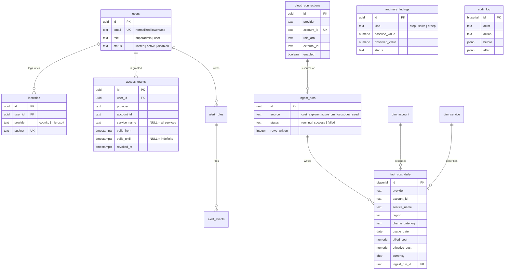

# Data model

13 tables in one PostgreSQL database. Migrations in `/migrations`, applied by
`python -m costhub.migrate`.

| # | Table | Migration | Purpose |
|---|---|---|---|
| 1 | `schema_migrations` | 001 | which files have run |
| 2 | `users` | 001 | one row per person |
| 3 | `identities` | 001 | login methods → user |
| 4 | `access_grants` | 001 | **who may see what** |
| 5 | `audit_log` | 001 | append-only change history |
| 6 | `cloud_connections` | 004 *(pending)* | registered cloud accounts |
| 7 | `ingest_runs` | 002 | lineage for every fact write |
| 8 | `dim_account` | 002 | account names |
| 9 | `dim_service` | 002 | service names + FOCUS category |
| 10 | `fact_cost_daily` | 002 | **the daily rollup** |
| 11 | `alert_rules` | 003 | rule definitions |
| 12 | `alert_events` | 003 | firing history |
| 13 | `anomaly_findings` | 003 | detections |

---

## ERD



---

## Audit conventions

### Audit columns — on every table that records a human action

```sql
created_at timestamptz NOT NULL DEFAULT now(),
created_by text        NOT NULL,
updated_at timestamptz NOT NULL DEFAULT now(),
updated_by text,
deleted_at timestamptz,          -- soft delete; no hard DELETE
deleted_by text,
revision   integer     NOT NULL DEFAULT 1
```

Seven of the thirteen tables deliberately carry less: `schema_migrations`
and `audit_log` have none at all (one is bookkeeping, the other *is* the
trail), and `ingest_runs`, `dim_account`, `dim_service`, `alert_events`
and `anomaly_findings` omit `deleted_at`/`deleted_by` because nothing
soft-deletes them. This section used to say "no exceptions".

**A distinction worth being deliberate about.** For human-edited tables
`created_by` is a user email. For machine-written fact rows it is the ingest
job identity, and the meaningful trail is **lineage** — so `fact_cost_daily`
additionally carries `ingest_run_id` and `source`. Same columns, different
semantics; both are needed.

### Audit log — append-only

Separate from the columns above. Records *what changed*, with `before` and
`after` as JSONB. Only access-affecting changes go here: grants, users,
connections. It is written **inside the caller's transaction** (see
`audit.log()` taking a cursor, not a connection) — an audit log that can
disagree with the data is worse than none.

Enforced append-only by **statement triggers**, not convention — and not by grants, which was claimed here for a long time and never existed:

```sql
-- migration 005: BEFORE UPDATE/DELETE statement triggers that RAISE.
-- The accompanying REVOKE is belt-and-braces only: Postgres grants
-- nothing to PUBLIC by default, and the app connects as the table owner,
-- which keeps implicit rights regardless. The triggers are the control.
CREATE TRIGGER audit_log_no_update BEFORE UPDATE ON audit_log
  FOR EACH STATEMENT EXECUTE FUNCTION audit_log_is_append_only();
```

TRUNCATE is **not** covered — the test suite truncates `audit_log`
between tests, which is the proof. A production role should not hold
TRUNCATE on it.

---

## `access_grants` — the important one

| Column | Meaning |
|---|---|
| `service_name = NULL` | all services in that account |
| `valid_until = NULL` | indefinite |
| `revoked_at NOT NULL` | revoked; never matches, never deleted |

```sql
CHECK (valid_until IS NULL OR valid_until > valid_from)

CREATE INDEX idx_grants_lookup
  ON access_grants (user_id, provider, account_id)
  WHERE revoked_at IS NULL AND deleted_at IS NULL;
```

Grants reference `users.id`, **never the IdP subject**. That is what makes
adding Microsoft OAuth later an insert into `identities` rather than a
migration of every grant.

`principal_type` is intentionally *not* present yet. Per-user grants stop
scaling around 25–30 people; adding group support means one column plus a
branch in the predicate. Noted in [10-todo-future.md](10-todo-future.md).

---

## `fact_cost_daily` — the rollup

**Grain:** `date × provider × account × service × region × charge_category`

Column names follow FOCUS (`BilledCost` → `billed_cost`,
`EffectiveCost` → `effective_cost`, `ChargeCategory` → `charge_category`,
`ServiceName` → `service_name`) so the FOCUS-export adapter needs no
translation layer (NFR-20).

### Four decisions embedded here

**Both cost measures stored.** `billed_cost` reconciles to the invoice;
`effective_cost` is amortised and is what comparisons should use. A chart
that does not state which it shows will be disputed.

**`numeric(18,6)`, never float.** This is money (NFR-7).

**Natural-key uniqueness** makes re-ingestion idempotent:

```sql
UNIQUE (provider, account_id, service_name, region,
        charge_category, usage_date, currency)
```

Cost data is restated as it finalises, so recent days get re-fetched
routinely. Without this, every re-run duplicates. Writes use
`ON CONFLICT ... DO UPDATE`.

**`charge_category` is part of the key** so `Tax`, `Credit` and `Adjustment`
rows stay separable — they must be excluded from per-service comparisons
(FR-23) but still sum to the invoice.

### Volume

Two accounts × ~30 services × ~5 regions × 30 days ≈ **~9,000 rows/month**.
Three years would still be under half a million. This is a small database;
the design is for clarity, not scale.

### No synthetic data in this table

`source` records lineage (`cost_explorer` | `azure_cm` | `focus` |
`dev_seed`), not a display mode. The demo's multi-account and Azure views
are **frontend fixtures** and never become rows here.

That is deliberate. Storing them would collide with real rows on the natural
key above — `source` is not part of it — and would create a path by which
synthetic data could be served as real. Keeping them in the frontend means
removal is deleting a directory rather than a migration plus a data cleanup
(FR-41, FR-43).

`dev_seed` is the one exception, and it only ever runs against a local
development database.

---

## `cloud_connections` (migration 004, pending)

Backs the UI "Connect account" form (FR-11).

| Column | Note |
|---|---|
| `provider`, `account_id` | unique together |
| `display_name` | shown in the UI |
| `role_arn` | role to assume in the target account |
| `external_id` | confused-deputy protection |
| `credential_mode` | `self` \| `assume_role` \| `profile` \| `secret` — see below |
| `enabled` | disable without losing history |
| `last_ingest_at`, `last_ingest_status` | surfaced on the connections screen |

The four modes, as enforced by the `CHECK` in `004_connections.sql`:

| Mode | Used for | How credentials are obtained |
|---|---|---|
| `self` | the deploy account itself | the Lambda's own execution role — nothing to configure |
| `assume_role` | another AWS account | `sts:AssumeRole` with `role_arn` + `external_id`; a second `CHECK` enforces that `role_arn` is present |
| `profile` | local development only | a named AWS CLI profile on the developer's machine |
| `secret` | **Azure** | a service principal read from Secrets Manager via `secret_arn` |

`secret` exists because Azure has no cross-cloud equivalent of
`AssumeRole`, so a long-lived client secret is unavoidable. Note that
`credentials.py` dispatches on **provider** first: an AWS connection set
to `secret` is rejected as an unsupported mode rather than silently
trying the Azure path.

**No secret is stored here** (FR-12). For `self` and `assume_role` there is
nothing to store; for `secret` the column holds a Secrets Manager ARN,
read at call time, never a value.

---

## Indexes

| Index | Supports |
|---|---|
| `idx_grants_lookup` | the grant predicate |
| `idx_fact_scope (provider, account_id, usage_date)` | time series, account breakdown |
| `idx_fact_service (provider, account_id, service_name, usage_date)` | service breakdown, per-service anomaly scan |
| `idx_audit_entity`, `idx_audit_actor` | audit queries |
| `idx_anomaly_open` partial on `status='new'` | the anomaly feed |
| `idx_alert_events_rule` | firing history |

All fact indexes are partial on `deleted_at IS NULL`.

---

## Conventions

- All timestamps `timestamptz`, stored UTC, displayed local (NFR-8)
- `uuid` primary keys via `gen_random_uuid()` for app tables; `bigserial` for
  high-volume append tables (`fact_cost_daily`, `audit_log`)
- `CHECK` constraints for enums rather than Postgres `ENUM` types — adding a
  value is a migration, not a type alteration
- No hard deletes anywhere except `terraform destroy`
