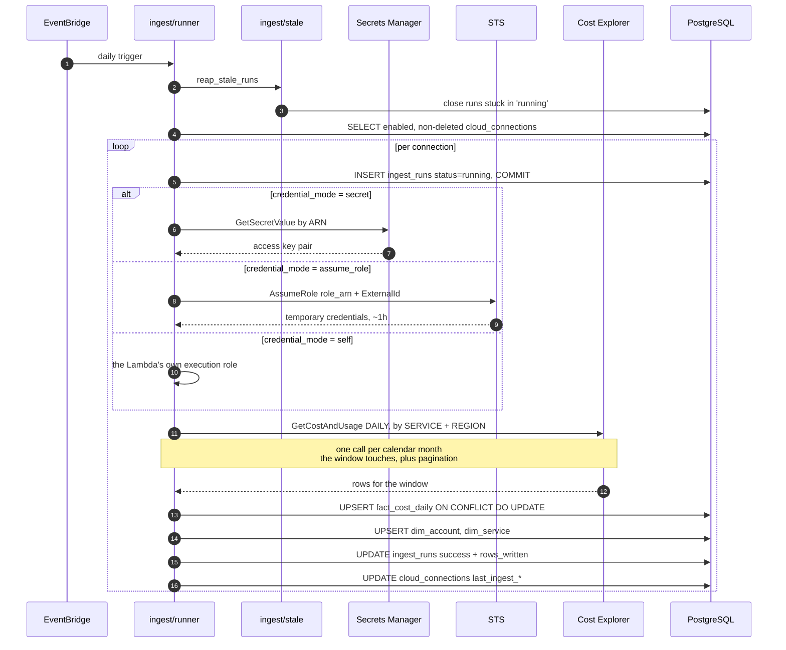
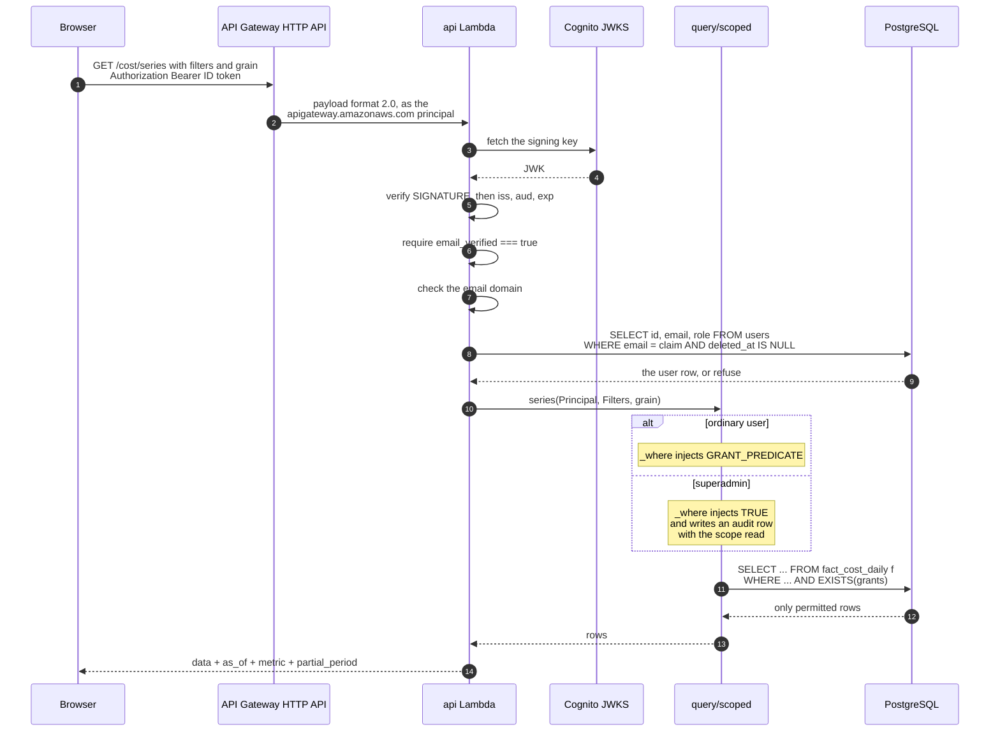
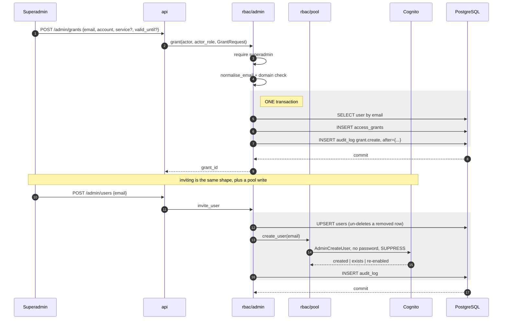
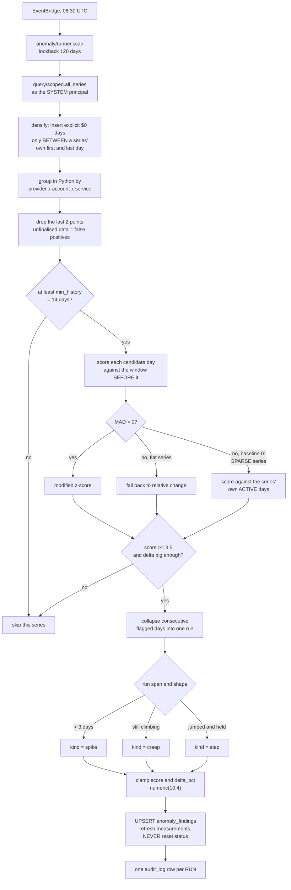
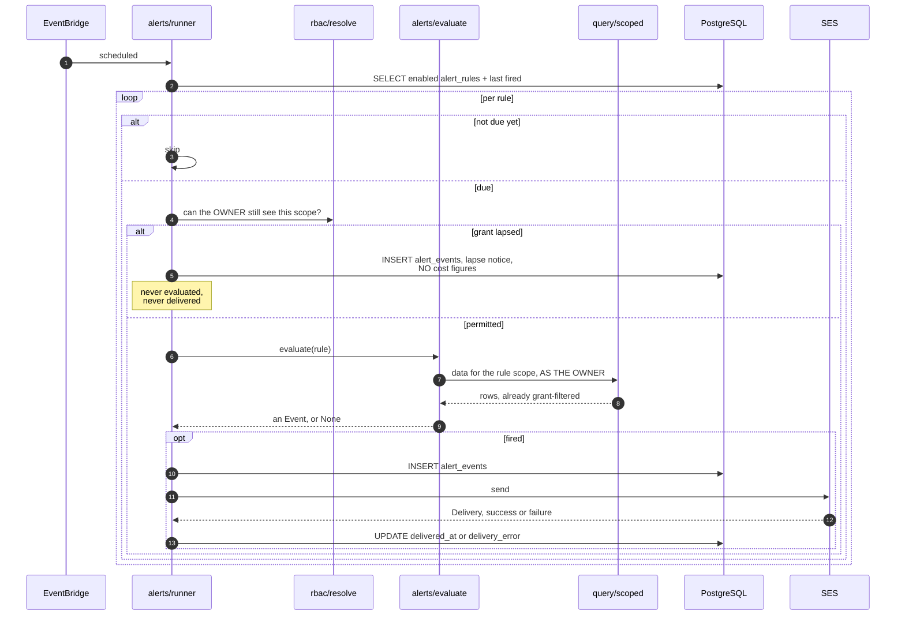

# Data flows

Five flows: ingest, scoped read, access change, anomaly detection,
alerting.

Two more sequences live elsewhere because they belong to one subject each:
**signing in** is in [07-security-rbac.md](07-security-rbac.md), and
**registering an account then importing from it** — including the two-stage
probe — is in
[17-connection-lifecycle.md](17-connection-lifecycle.md).

---

## 1. Ingest

`cron(0 6 * * ? *)`, once per enabled connection.

### Why it looks like this

- **The run row is committed before fetching**, so a crash leaves a
  `running` row that is visibly stuck rather than silently absent. The
  other half of that design is `reap_stale_runs`, which is what closes a
  row whose process was killed — see
  [17-connection-lifecycle.md](17-connection-lifecycle.md).
- **A failed account does not abort the others** (FR-17). The loop catches
  per connection and records `failed` with the error.
- **The window is a trailing re-fetch**, not just yesterday, because AWS
  restates cost as it finalises. The natural-key upsert makes that safe and
  idempotent (FR-15). The default is 7 days plus today, overridable by
  `INGEST_DAYS` or an `event.days`.
- **Failures are surfaced, not raised.** The handler returns `ok: false`
  with the per-connection errors, because a silent ingest failure looks
  exactly like "costs went to zero", so the schedule must report it.
- **`credential_mode = profile` cannot run here at all.** There is no AWS
  CLI configuration in a Lambda execution environment, so such a connection
  fails every scheduled run permanently.

### Granularity

Cost Explorer supports `DAILY` and `MONTHLY`. We fetch `DAILY` and
aggregate upward in SQL with `date_trunc`, so week, month, quarter and year
views come from one ingest path rather than four.

---

## 2. Scoped read — the authorisation path

Every chart in the product goes through this.

### The two rules

1. **`Principal` is built from the verified token**, never from a request
   body or a query parameter. A `user_id` in a request is ignored.
2. **The grant predicate is applied in SQL**, so unauthorised rows never
   leave the database. Filtering in the API — or worse, the frontend —
   would mean fetching data the user may not see.

### Fail closed

No grants → the `EXISTS` subquery matches nothing → **zero rows**. Not an
error, not everything. `test_no_grants_sees_nothing` is the first test in
the suite.

Note where that lands in HTTP terms: a user with no grants gets **200 with
an empty list**, and a non-superadmin hitting an admin route gets **403**.
Both are designed states, and the frontend must render an empty state for
either — never a sign-in loop.

### Superadmin

The predicate is replaced with the literal `TRUE`, and the bypass is
recorded in `audit_log` with the scope that was read (FR-38), throttled per
actor and scope per hour. An unlogged bypass is indistinguishable from a
leak.

It is recorded in `query/scoped._note_bypass`, at the point the predicate
is actually replaced — not at authentication time, which recorded "a
superadmin signed in" and no scope at all.

---

## 3. Access change

The shaded regions matter: the change and its audit entry commit together
(FR-37). Revocation is the same shape — `UPDATE ... SET revoked_at` plus an
audit row — and it is idempotent, so revoking twice is a no-op.

**Inviting needs both halves.** For a while it was only one:
`invite_user` wrote the `users` row and stopped, so an invited teammate got
a database row, Cognito had never heard of them, and no code could ever be
sent. The pool write is inside the same transaction, so a pool failure
rolls the `users` row back and a failed invite leaves nothing behind.

**Effect is immediate.** Nothing is cached, and the predicate evaluates
`now()` per query, so the next page load reflects the change.

---

## 4. Anomaly detection

`cron(30 6 * * ? *)` — half an hour after ingest, so it scores what ingest
just wrote.

### Four decisions

**Per account × service, never the aggregate** (FR-26). A doubling of one
small service vanishes in the account total. Scanning the sum finds nothing
and feels productive.

**Step changes first** (FR-27). Cloud cost anomalies are overwhelmingly
"something was switched on and stayed on". A spike detector on cost data
mostly surfaces billing artefacts and trains people to ignore alerts.

**Median and MAD, not mean and standard deviation.** Robust to exactly the
outliers being hunted, and explainable — we can state why a point flagged,
which matters when the output is "you may be wasting money".

**One query, grouped in Python.** Fetching each series separately would be
thousands of round-trips. The whole window comes back once, through
`query/scoped` as the system principal — a named, greppable function, not a
scattered role literal, and one audit row per run rather than per query.

**This is ours, not AWS Cost Anomaly Detection.** Consuming AWS's managed
detector is TODO-17 and would require creating the SNS topic that does not
exist. The scoring, the clamps and the sparse-series behaviour are
described in [05-backend.md](05-backend.md).

Findings always carry baseline and observed values (FR-30): the
explanation, not just the flag.

---

## 5. Alerting

`cron(0 7 * * ? *)` — after detection, so an `anomaly` rule has something
to fire on.

### The re-check that is easy to miss

A rule can outlive the grant that justified it. Somebody is granted an
account for two weeks, creates an alert, the grant expires — and the rule
would keep emailing them about an account they can no longer open.

So grants are re-evaluated **before the rule is even evaluated** (FR-34),
not trusted from the rule's stored scope. Checking at *send* time was the
original design and it was wrong in a subtle way: rules evaluate as their
owner through `query/scoped`, so a lapsed grant already yields no data and
therefore no alert — safe, but **silent**. The owner simply stops hearing
anything and concludes spend is fine.

The check therefore runs first, and records a notice carrying **no cost
figures**: the signal survives without leaking amounts into a feed its
owner is no longer entitled to read. Throttled to once a day.

### Rule types

| Type | Condition |
|---|---|
| `threshold` | the metric over the window crosses a value. The window is N **settled** days ending yesterday — anchoring on today summed an always-empty day |
| `forecast` | a linear run-rate projects to cross before the period ends |
| `digest` | an unconditional periodic summary |
| `anomaly` | a new `anomaly_findings` row in scope |

`ses.py` never raises; it returns a failed `Delivery`, which is recorded as
`delivery_error` on the event. In-app delivery is a row in `alert_events`
the UI reads — more demonstrable than email, and it works with no SES
recipient verification.

---

## 6. End-to-end latency

Worth stating plainly, since the UI must never imply real-time (NFR-10):

| Stage | Lag |
|---|---|
| AWS publishes cost data | 8-24 h |
| Monthly finalisation | up to about a month |
| Our ingest schedule | daily, 06:00 UTC |
| **Total worst case** | **~48 h** |

Every view therefore shows an as-of timestamp, drawn from
`MAX(ingest_runs.finished_at) WHERE status = 'success'` (FR-25). The
sidebar says "data as of …", never "live".

Two places treat recency as untrustworthy on purpose, for the same reason
and with different numbers:

| Consumer | How much it drops | Why |
|---|---|---|
| the anomaly detector | the last **2** points of each series | scoring unfinalised days produces an anomaly every morning |
| `GET /insights` default window | ends **3 days** ago, `insights/coverage.last_final_day()` | a window ending on an unfinalised day reads as a fall that is only missing data |

Until an ingest completes, live mode says "no data ingested yet" and every
cost screen shows an empty state. That is the correct result, not a
failure.
