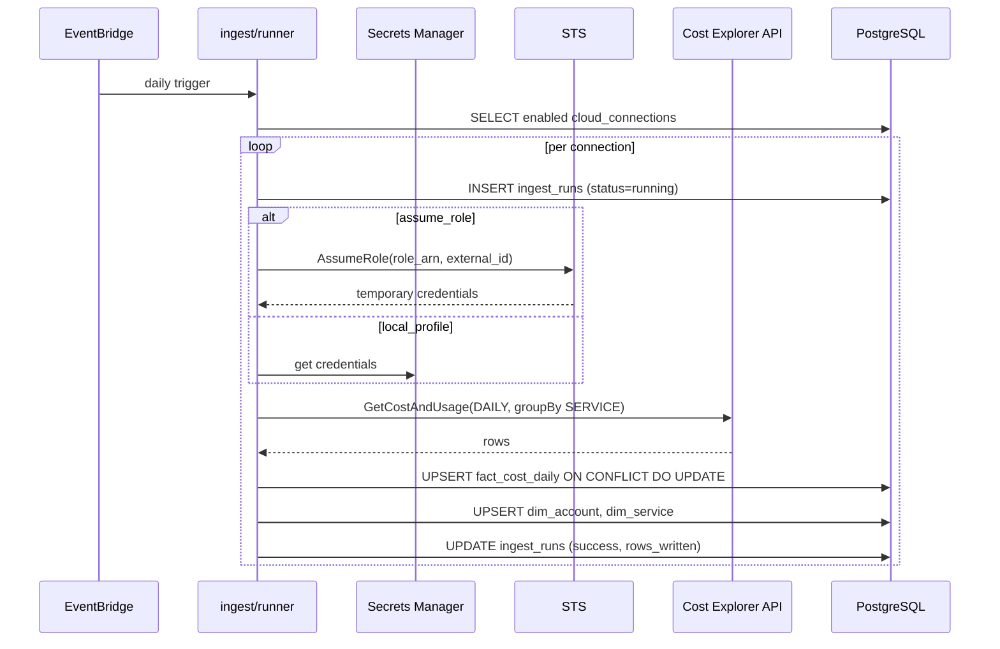
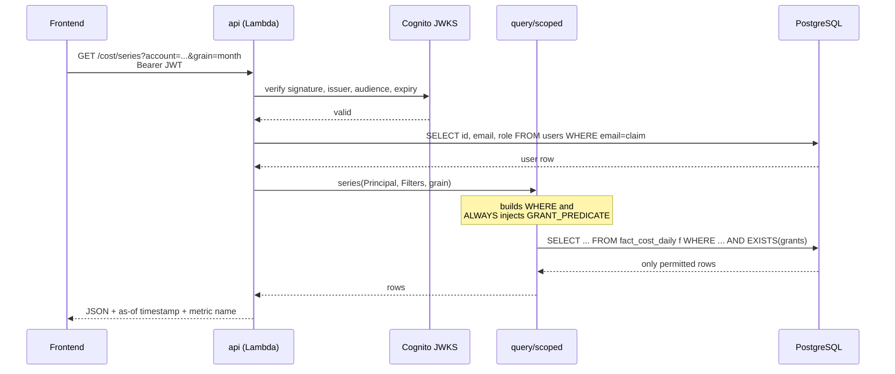
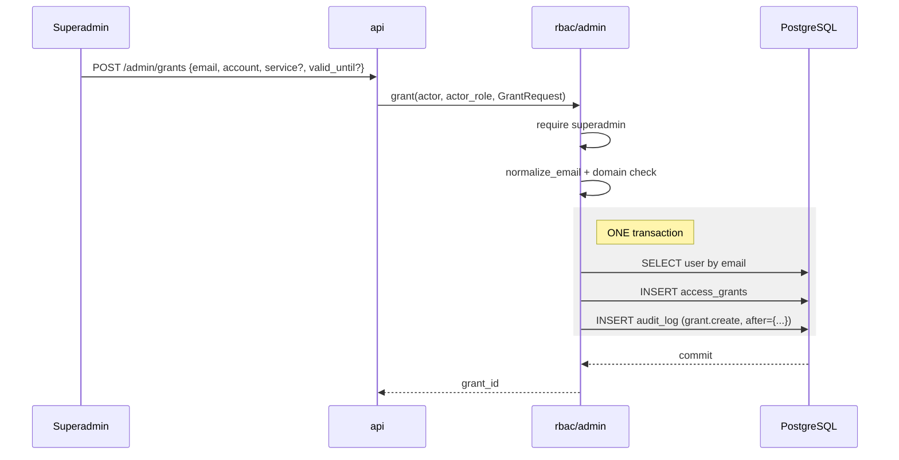
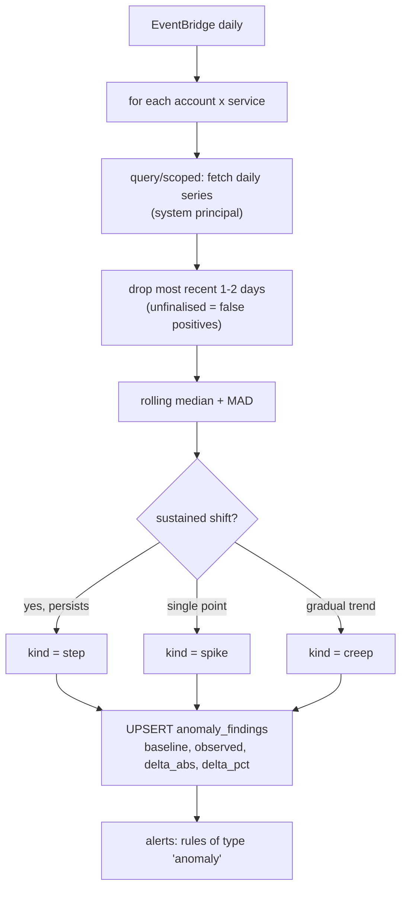
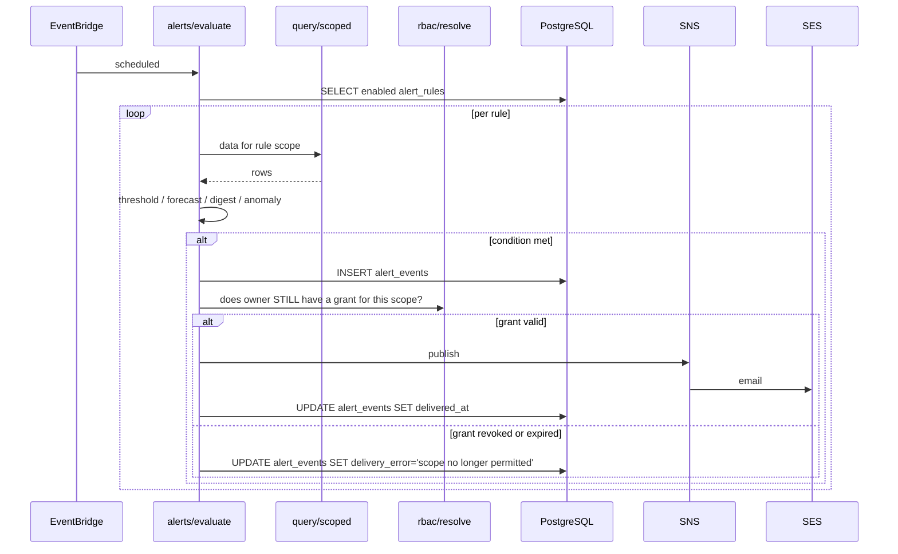

# Data flows

Five flows: ingest, scoped read, access change, anomaly detection, alerting.

---

## 1. Ingest

Runs on a schedule, once per enabled connection.

### Why it looks like this

- **One run row per connection per period**, written *before* fetching, so a
  crash leaves a `running` row that is visibly stuck rather than silently absent.
- **A failed account does not abort the others** (FR-17). The loop catches per
  connection and records `failed` with the error.
- **Re-fetch window.** Each run re-fetches the trailing ~7 days, not just
  yesterday, because cost data is restated as it finalises. The natural-key
  upsert makes that safe and idempotent (FR-15).
- **Credentials never persist.** `AssumeRole` returns short-lived credentials
  used for that call only.

### Granularity note

Cost Explorer supports `DAILY` and `MONTHLY`. We fetch `DAILY` and aggregate
upward in SQL (`date_trunc`), so week/month/quarter/year views come from one
ingest path rather than four.

---

## 2. Scoped read — the authorization path

Every chart in the product goes through this.

### The two rules

1. **`Principal` is built from the verified token**, never from a request body
   or query parameter. A `user_id` in a request is ignored.
2. **The grant predicate is applied in SQL**, so unauthorized rows never leave
   the database. Filtering in the API — or worse, the frontend — would mean
   fetching data the user may not see.

### Fail-closed

No grants → the `EXISTS` subquery matches nothing → zero rows. Not an error,
not everything. This is the first test in the suite.

### Superadmin

Replaces the predicate with `TRUE` and the bypass is recorded in `audit_log`
(FR-38). An unlogged bypass is indistinguishable from a leak.

---

## 3. Access change

The shaded region matters: the grant and its audit entry commit together
(FR-37). Revocation is the same shape — `UPDATE ... SET revoked_at` plus an
audit row, and it is idempotent (revoking twice is a no-op).

**Effect is immediate.** Nothing is cached, and the predicate evaluates
`now()` per query, so the next page load reflects the change.

---

## 4. Anomaly detection

### Three decisions

**Per account × service, never the total** (FR-26). Aggregates average
anomalies away — a doubling of one small service disappears in the sum.

**Step changes, not spikes** (FR-27). Cloud cost anomalies are overwhelmingly
"something was switched on and stayed on". A spike detector on cost data
mostly surfaces billing artefacts and trains people to ignore alerts.

**Median + MAD, not mean + stddev.** Robust to the outliers we are looking
for, and explainable — we can state exactly why a point flagged, which
matters when the output is "you may be wasting money".

Findings always carry baseline and observed values (FR-30): the explanation,
not just the flag.

---

## 5. Alerting

### The re-check that is easy to miss

A rule can outlive the grant that justified it. Somebody is granted an
account for two weeks, creates an alert, the grant expires — and the rule
would keep emailing them about an account they can no longer open.

So **grants are re-evaluated at send time** (FR-34), not trusted from the
rule's stored scope. The event is still recorded, with a delivery error
explaining why it was suppressed.

### Rule types

| Type | Condition |
|---|---|
| `threshold` | metric over window crosses a value |
| `forecast` | linear run-rate projects to cross before period end |
| `digest` | unconditional periodic summary |
| `anomaly` | a new `anomaly_findings` row in scope |

In-app delivery is a row in `alert_events` the UI polls — more demo-able than
email, and it works with no SES verification.

---

## 6. End-to-end latency

Worth stating plainly, since the UI must not imply real-time (NFR-10):

| Stage | Lag |
|---|---|
| AWS publishes cost data | 8–24 h |
| Monthly finalisation | up to ~a month |
| Our ingest schedule | daily |
| **Total worst case** | **~48 h** |

Every view therefore shows an as-of timestamp drawn from
`MAX(ingest_runs.finished_at)` (FR-25).
