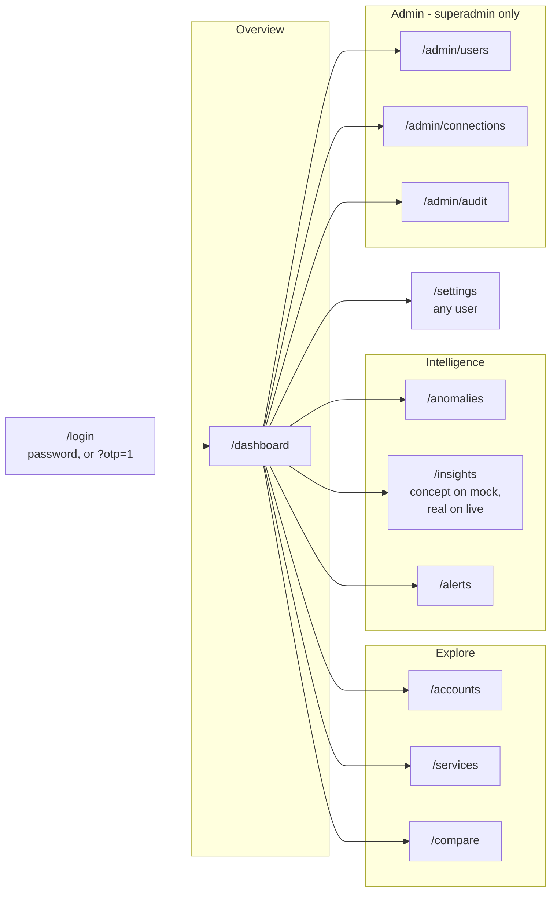

# Frontend

**Next.js 15, app router.** React 19, TypeScript, Tailwind, Recharts,
deployed to Amplify Hosting on the `WEB_COMPUTE` platform.

There is **no Vite app in this repository** and there never will be: `git
ls-files` finds no `vite.config`, and `npm run dev` is `next dev`. A
previous frontend was Vite-based and is gone; wherever a `VITE_*` variable
name or a port 5173 survives in prose, it is wrong. Next only exposes a
variable to browser code when its name starts with `NEXT_PUBLIC_`, so the
old names were being set and silently ignored.

A 388-line `14-frontend-build-spec.md` used to sit beside this page
describing a nine-page Vite app with a different route set. It was intent
that the build diverged from, and it has been deleted rather than left as a
trap. This page is the one description of the frontend.

---

## Pages

Routes are directories under `frontend/src/app/`. Two route groups:
`(app)` is the signed-in shell, `(auth)` is the sign-in chrome.

| Route | Page | Access |
|---|---|---|
| `/` | redirects to `/dashboard` | — |
| `/login` | sign in | public |
| `/auth/callback` | OAuth code exchange | public |
| `/register`, `/forgot-password`, `/reset-password` | **mock-only** — closed off in live mode, with the reason | public |
| `/dashboard` | KPIs, trend, top services, anomalies panel, insights preview | any user |
| `/accounts` | per-account spend, connection state, account detail | any user |
| `/services` | per-service spend | any user |
| `/compare` | period, account and service comparison | any user |
| `/anomalies` | findings, filters, timeline, investigation | any user |
| `/insights` | narrated insight cards | any user |
| `/alerts` | rules and the in-app feed | any user |
| `/admin/users` | users and grants | **superadmin** |
| `/admin/connections` | cloud accounts | **superadmin** |
| `/admin/audit` | append-only change history | **superadmin** |
| `/settings` | data source, notifications, reset browser state | any user |



### The nav is one file

`src/components/layout/nav-config.ts` is the single source for what the
sidebar shows. `navGroupsFor(isSuperadmin)` returns filtered groups rather
than a flag per item, so the sidebar renders whatever it is handed and a
future role cannot leak a link by forgetting a check at the render site.

Admin links are **hidden** from non-superadmins, not merely disabled — a
disabled link still tells you the page exists. This is convenience, **not
access control**: the API answers 403 for a non-superadmin whatever the
sidebar renders.

Two flags on a nav item are worth knowing because they are honesty
mechanisms, not decoration:

- `ready: false` means "coming", and renders a `Soon` tag.
- `concept` means "this page describes a capability nothing is wired to",
  and is labelled **permanently** rather than optimistically. `concept:
  'mock'` means it is a concept only while the app is on mock data and is
  wired to a real endpoint in live mode. `/insights` is the one item
  carrying it.

### The three mock-only auth pages

Register, forgot-password and reset-password read and write `localStorage`
and nothing else. In live mode the user directory is a Cognito user pool,
accounts are created by an administrator through `POST /admin/users`, and
password recovery is Cognito's own — so these pages would present a
working-looking form that creates an account which cannot sign in to
anything. That is "a capability that cannot be real", reachable by typing
the URL.

They are not deleted, because in mock mode they are a real part of what the
product looks like in use. `MockOnlyRoute` closes them off in live mode
instead, states the reason on screen, and links to the sign-in that works.

---

## Signing in

Live mode has **two** paths, and the default is not the one the backend
provisions users for.

| Path | How | Reached |
|---|---|---|
| Email and password | posted straight to Cognito `InitiateAuth` with `USER_PASSWORD_AUTH`, so the form is ours and the user never leaves | the default form on `/login` |
| Email one-time code | hand-off to Cognito **Managed Login**, which owns the OTP screen | `/login?otp=1`, or automatically when Cognito bounces an authorize request back with an `error` |

The OTP path is a hand-off because it has to be: the pool is passwordless
email OTP, which requires Managed Login (`managed_login_version = 2`), and
there is no SDK call this app could make to replace that screen. The
authorization-code flow uses **PKCE** even though the client has no secret
— a public client cannot authenticate itself to the token endpoint, so the
code alone bears the grant, and S256 PKCE binds it to this browser. The
verifier lives in `sessionStorage` for exactly one round trip and is
deleted the moment it is used, including on failure.

> **Unresolved contradiction, worth checking before a demo.** Nothing in
> the backend ever sets a Cognito password: `rbac/pool.create_user` calls
> `AdminCreateUser` with no `TemporaryPassword`, and
> `aws_cognito_user.superadmin` sets none either, so every invited user is
> created passwordless and `CONFIRMED`. The password form is therefore the
> default path for users who have no password, and `/login?otp=1` is the
> path that can actually complete. This is a code-versus-code
> disagreement, not a documentation gap — recorded here rather than
> papered over.

Both paths converge on `establishSession`, whose last step is `GET
/meta/me`. **The role comes from the server, not from the token.** A
Cognito ID token carries identity (`email`, `email_verified`) and knows
nothing about this application's `users` table, where the role lives. That
call is also the first real authenticated request, so a token the API will
not accept fails at sign-in rather than on the dashboard.

Signing out redirects to Cognito's `/logout`. Clearing local state is not
signing out: Cognito keeps its own session cookie, so the next authorize
request returns a code immediately with no OTP prompt and the user is
straight back in.

---

## Talking to the API

`src/lib/api/client.ts` is the one place the browser calls the API.
Everything it does is a consequence of how the server behaves.

| Behaviour | Why |
|---|---|
| `Authorization: Bearer <ID token>` | not the access token — the API needs the `email` and `email_verified` claims, which only the ID token carries |
| Refresh **before** the request, not after a 401 | the ID token lives 60 minutes and a dashboard sits open longer than that, so expiry is routine. Reacting to a 401 would mean every page showing one failure per hour first |
| A single shared refresh | six panels mounting at once would otherwise fire six refreshes, and Cognito answers the losers with an error for a token that was perfectly good |
| 401 and 403 handled differently | 401 means the token is unusable, so re-authenticate. 403 means the server knows exactly who the caller is and is refusing — no grants, not a superadmin, domain not permitted. That is a **designed state** and must surface as an empty state, never as a sign-in loop |
| `NetworkError` as its own type | DNS, CORS and offline are not the same as a server answer |
| `camelKeys` on every response | the API is `snake_case`; the components are not |

There is deliberately no `unauthorized` flag on `ApiError`: a 401 is
intercepted and turned into a re-authentication, so no caller is left in a
position to inspect it.

---

## Mock and live

The app runs in one of two modes, decided at **runtime**, not at build
time. Full operator guide in [15-mock-vs-live.md](15-mock-vs-live.md).

`NEXT_PUBLIC_USE_MOCK` is inlined into the bundle by the compiler, so
changing it means a rebuild and, on Amplify, a redeploy — the wrong cost
for a decision someone wants to make mid-demo. So the whole mechanism is
three things:

1. `isMock()` in `src/lib/mode.ts` — the `localStorage` override if one is
   set, otherwise the build default. Every data-access module calls this
   and nothing else.
2. a switch on `/settings` that writes the override.
3. `location.reload()` after writing it.

The reload is what keeps the rest simple. Without it, every cached query,
every context holding fetched rows and every module-level memo would have
to learn to invalidate itself, and the two modes would have to be able to
interleave. With it, a mode lasts exactly one document lifetime and no code
anywhere handles a change. There is no context, no provider, no per-call
flag.

**`?mock=1` on any URL is the way back in** when the app will not load, and
the parameter is written to the override as it is read, so one visit is
permanent. Without it, switching to live with no Cognito session is a
one-way door: the API answers 401, the client sends the browser to
`/login`, and `/login` in live mode redirects to Cognito — so if Cognito is
unreachable, which is the exact situation the toggle exists for, every
route bounces and the switch on `/settings` is behind the bounce.

**Live mode is refused when the build cannot support it.** `USE_MOCK` is
true unless `NEXT_PUBLIC_USE_MOCK` is the exact string `"false"` **and**
`NEXT_PUBLIC_API_BASE_URL`, `NEXT_PUBLIC_COGNITO_CLIENT_ID` and
`NEXT_PUBLIC_COGNITO_DOMAIN` are all present. A live mode that cannot
reach anything is worse than the mock it replaced. When it is refused the
app says so in the console naming the missing variable, and `/settings`
names it on screen — silently handing back mock after someone asked for
live is the single most confusing thing the flag can do.

### Server rendering and the mode

`localStorage` does not exist during prerender, so `isMock()` returns the
build default there. A component whose output depends on the mode must not
decide it during the first render, or the server HTML and the hydrated tree
disagree.

Inside the shell that is handled structurally: `<AppDataGate>` renders a
spinner on the server **and** on the first client render, so nothing
mode-dependent beneath it takes part in hydration. The components outside
the gate — the sign-in chrome and the data-source badge — use `useMode()`,
which resolves in an effect.

### The rule on mock data

Mock exists to show what the product looks like in use. **It must never
show a capability that cannot be real.** Anything the API has no column for
is dropped or dashed in live mode rather than filled with a zero. An empty
real chart is fine; a fabricated one is not.

Two consequences that will rot silently if ignored:

- **Service names in `lib/mock/catalog.ts` are exactly what the cost APIs
  return** — `Amazon Relational Database Service`, never `RDS` — because
  `ingest/cost_explorer.py` writes the `SERVICE` dimension to
  `service_name` verbatim and live mode shows it. They are long on
  purpose. Charts shorten them with `compactServiceLabel`, which must keep
  working on **live** rows, so it must not be replaced with a mock-only
  lookup table.
- **`npm run verify:data` is a gate, not a report.** It exits non-zero, and
  it checks FinOps plausibility as well as integrity: category mix,
  weekend seasonality per category, control-plane magnitudes, planted-event
  coverage in both directions, budget spread, comparison-delta bounds. Run
  it after touching anything under `lib/mock/`.

---

## Code layout

```
frontend/src/
├── app/
│   ├── (app)/            the signed-in shell and its pages
│   ├── (auth)/           login, callback, the three mock-only flows
│   └── layout.tsx        root layout, theme provider
├── components/
│   ├── layout/           app-shell, sidebar, header, nav-config,
│   │                     app-data-gate, data-source-badge
│   ├── charts/           spend-over-time, breakdown-bars, comparison,
│   │                     provider-donut, sparkline, period-overlay
│   ├── filters/          filter-bar + filters-context
│   ├── dashboard/        kpi grid, top services, anomalies panel,
│   │                     insights preview, export menu
│   ├── accounts/         accounts view, connect/disconnect/reconnect
│   ├── services/         services view
│   ├── compare/          compare view, head-to-head, comparison table
│   ├── anomalies/        table, filters, timeline, investigation,
│   │                     detection settings
│   ├── insights/         insight cards, live-insights, ai-summary
│   ├── alerts/           rules, feed, notification bell + preferences
│   ├── admin/            users, grants, connections, audit, dialogs
│   ├── settings/         data-source card
│   ├── shared/           empty, error and no-data states
│   └── ui/               the primitive set: button, card, dialog,
│                         table, select, switch, toast, skeleton …
├── lib/
│   ├── api/              client, cost-api, insights-api, case
│   ├── auth/             cognito (PKCE), session, tokens, store
│   ├── live/             live-mode data assembly per screen
│   ├── mock/             the mock estate: catalog, dataset, generators
│   ├── selectors/        shaping rows for charts
│   ├── services/         session-service and friends
│   ├── insights/         the mock-mode rule pass
│   ├── config.ts         NEXT_PUBLIC_* read once
│   └── mode.ts           isMock(), the override, ?mock=
├── hooks/
└── types/
```

`lib/live/` and `lib/mock/` are deliberately parallel: a screen's data
module branches on `isMock()` once and hands the same shape to the same
components either way.

---

## Rules for the frontend

1. **Authorisation is never a frontend concern.** The UI hides what the
   user cannot use; the API decides what they may see. Both, independently.
2. **No unscoped list is ever fetched.** Account and service options come
   from `/meta/accounts` and `/meta/services`, which are server-scoped.
   This is what makes the RBAC visible rather than merely claimed, and it
   only holds if the frontend never receives an unscoped list.
3. **Every chart states its measure and its as-of time.**
   `effective_cost` and `billed_cost` give different numbers; an
   unlabelled chart will be disputed.
4. **Incomplete periods are labelled.** The single most common way a cost
   dashboard looks broken is a month-to-date compared against a full month.
5. **Both deltas, always.** `$2 → $6` is `+200%` and also `+$4`. Only one
   of those is worth acting on.
6. **Empty states are explicit.** "No accounts have been shared with you
   yet", with a next step — never a blank chart, and never an error.
7. **The only credential input is the `secret`-mode access key pair**, in
   the connect dialog, write-only: POSTed once, never read back, never
   returned by any endpoint. Everything else a connection needs — role ARN,
   ExternalId, account id — is not a credential.
8. **`localStorage` holds per-viewer conveniences only**: the mock
   override, a theme, read marks, last-selected filters. Never cost data
   and never permissions.

### The screens that prove the RBAC

`FilterBar` and the empty states, together. Because the filter options come
from the server already scoped, signing in as a superadmin and then as a
restricted analyst shows the access control working in about fifteen
seconds, with no explanation needed. A user with no grants lands on an
empty state, which is the designed outcome of signing in successfully — not
a failure.

---

## Verification gates

Run before any commit; none of these is optional.

```bash
cd frontend
node_modules/.bin/tsc --noEmit -p tsconfig.json   # must be silent
node_modules/.bin/next build                      # must succeed
node_modules/.bin/next lint --file <changed files>
npm run verify:data                               # exits non-zero on failure
```

`next.config.mjs` ignores ESLint during builds but **not** TypeScript, so a
`tsc` error fails the Amplify build.

**Never run `next build` while a `next dev` server is up.** They share
`.next`, and the build wipes what dev is serving. Two symptoms seen:
`Cannot find module './NNN.js'`, and `/_next/static/css/app/layout.css`
returning 404 — which renders every page as unstyled text and looks exactly
like a blank screen. `touch` does not fix the CSS one; the watcher ignores
an mtime-only change. Make a real edit to `src/app/globals.css`, wait for
the recompile, then revert it. In a shared checkout your build breaks the
*other* session's dev server, not just yours.

**Port 3000, not 3001.** Cognito's callback list contains only
`http://localhost:3000/auth/callback`; any other port fails at Cognito with
`redirect_mismatch` before a code is issued. If something else holds 3000,
free it rather than adding a port to Cognito.

---

## Hosting

Amplify Hosting, `WEB_COMPUTE` platform, one branch per environment named
after the Terraform workspace.

| Point | Detail |
|---|---|
| Platform | `WEB_COMPUTE`, not `WEB`. `WEB` is static-only and serves a broken tree for a Next app |
| SPA rewrite | **none.** That `/<*>` → `/index.html` rule is right for a Vite SPA and actively wrong here — Next owns its own routing, and Amplify applies the correct Next rules itself on `WEB_COMPUTE` |
| Branch basic auth | **off.** It was the stakeholder gate from before Cognito worked. Turning it off widens who can load the page, not who can read data: an unauthenticated visitor still gets the sign-in screen and every `/admin` route still answers 401 |
| `NEXT_PUBLIC_*` | set in the **Amplify console**, not Terraform — see [11-configuration.md](11-configuration.md). Inlined at build time, so changing one needs a rebuild |
| Amplify Gen 2 | **not used.** It generates its own CDK-managed backend and would own resources outside this teardown |

---

## References

| Library | Docs |
|---|---|
| Next.js 15 | https://nextjs.org/docs |
| React 19 | https://react.dev |
| Recharts | https://recharts.org |
| Tailwind CSS | https://tailwindcss.com |
| lucide-react | https://lucide.dev |
| zod | https://zod.dev |
| next-themes | https://github.com/pacocoursey/next-themes |
| Amplify Hosting | https://docs.aws.amazon.com/amplify/latest/userguide/welcome.html |

**Chart library choice:** Recharts, for speed of delivery. Apache ECharts
is the upgrade if brush and zoom over long series is wanted; it is more
capable and more work.
