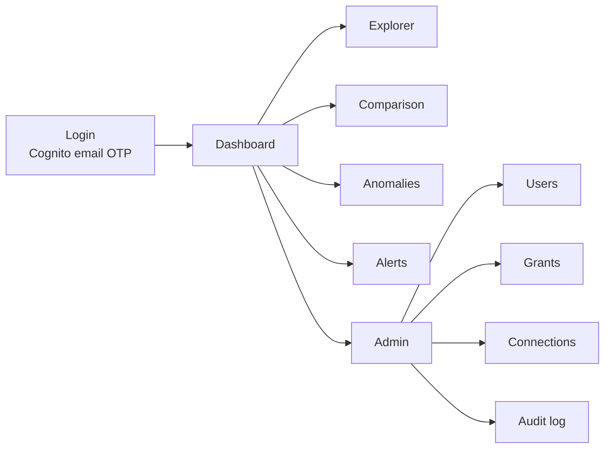

# Frontend components

React single-page app, static build, hosted on Amplify. Talks to the API
over HTTPS with a Cognito JWT.

---

## Screens



| Screen | Contents | Requirements |
|---|---|---|
| **Login** | Cognito Managed Login. Email → OTP code. No password, no register link, no forgot-password. | FR-1, FR-3 |
| **Dashboard** | KPI tiles (total, vs last period, open anomalies), trend chart, top services | FR-18, FR-19 |
| **Explorer** | Cascading filters + time grain + chart + breakdown table | FR-18–FR-20 |
| **Comparison** | One view, dimension selector: period / account / service | FR-21, FR-22 |
| **Anomalies** | Finding cards with baseline vs observed, acknowledge/dismiss | FR-26–FR-30 |
| **Alerts** | Rule builder + in-app feed with history | FR-31–FR-35 |
| **Admin → Users** | Invite by email, enable/disable | FR-1, FR-2 |
| **Admin → Grants** | Grant/revoke per account and service, optional expiry; shows expired and revoked rows flagged | FR-5–FR-7, FR-10 |
| **Admin → Connections** | Register cloud accounts: account id, role ARN, external id | FR-11–FR-13 |
| **Admin → Audit** | Append-only change history | FR-39 |

Admin screens are superadmin-only and hidden, not merely disabled, for
regular users — with the API enforcing it regardless of what the UI shows.

---

## Components

| Component | Responsibility | Notes |
|---|---|---|
| `FilterBar` | provider → account → service cascade + date range | **Populated from `/meta/accounts` and `/meta/services`, which are server-scoped.** Never filter client-side. |
| `TimeGrainToggle` | day / week / month / quarter / year | FR-18 |
| `CostChart` | time series line/area | shows `as_of` and metric name |
| `BreakdownChart` | horizontal bar by dimension | |
| `ComparisonTable` | current, previous, Δ absolute, Δ % | both deltas always (FR-22) |
| `KpiTile` | single number + delta + sparkline | |
| `PartialPeriodBadge` | marks incomplete periods | FR-24 — prevents the false "costs dropped 50%" read |
| `AnomalyCard` | kind, baseline vs observed, Δ, ack button | FR-30 |
| `AlertRuleForm` | type, scope, threshold, window, channels | FR-31–FR-33 |
| `AlertFeed` | in-app notification list | FR-33 |
| `GrantForm` / `GrantTable` | grant CRUD; account dropdown from data | FR-5–FR-7 |
| `ConnectionForm` | account id, role ARN, external id — **no credential fields** | FR-12 |
| `AuditTable` | actor, action, before/after diff | FR-36 |
| `EmptyState` | "no accounts have been shared with you yet" | FR-8 — a no-grant user must see this, never an error and never all data |
| `AsOfLabel` | data freshness | NFR-10 |

### The component that proves the RBAC

`FilterBar` is the demo's most important component. Because its options come
from the server already scoped, logging in as a superadmin (two accounts)
and then as a restricted analyst (one account, two services) shows the
access control working in about fifteen seconds — no explanation needed.

This only holds if the frontend **never** receives unscoped lists. If it
does, the whole claim collapses.

---

## Showcase fixtures (the mock toggle)

Two real AWS accounts prove the pipeline. They do not show what the product
looks like with **many** AWS and Azure accounts, because that data does not
exist yet. Showcase fixtures fill that gap — and they live **only in the
frontend**.

| | Proves | Path |
|---|---|---|
| Real data, 2 AWS accounts | pipeline, RBAC, anomaly, alerts genuinely work | full backend |
| **Showcase fixtures** | what 5 AWS + 3 Azure accounts *look like* | frontend only |

### Why not in the database

Storing fixtures behind a `source` column would collide with real rows on
the fact table's natural key, risk mock being served as real, and make
removal a migration plus a data cleanup. As a frontend fixture, removal is
deleting one file.

### The one rule

**Fixtures must match the API response envelope exactly** — same shape, same
field names, same `as_of` / `metric` / `currency` keys. Then switching off
mock is a flag, and when real multi-account data arrives you point at the
endpoint with zero component changes.

```ts
const data = USE_MOCK
  ? mockSeries                                // src/fixtures/showcase/*.json
  : await api.get('/cost/series', params)
```

### Requirements

1. **Off by default.** Real data is the default path.
2. **An unmissable banner while on.** Someone will screenshot a chart; if it
   is not obviously synthetic you will be correcting the record later.
3. **Removable.** Delete `src/fixtures/showcase/` and the flag; nothing else
   changes. The app must function identically without it.
4. **Available to everyone**, not superadmin-only. The banner is the
   safeguard, not the permission.
5. Fixtures cover multiple providers (`aws`, `azure`) and several accounts,
   since that is the entire point.
6. **RBAC is never demonstrated on fixtures.** Access control is shown on
   real data with real grants. Fixtures show layout and scale, nothing more.

## State and data fetching

| Concern | Approach |
|---|---|
| Server data | TanStack Query — caching, refetch, loading states |
| Auth | AWS Amplify JS (`aws-amplify/auth`) against Cognito |
| Routing | React Router |
| Forms | react-hook-form + zod |
| Charts | Recharts |
| Styling | Tailwind + shadcn/ui |
| Dates | date-fns |

Local `localStorage` holds only per-viewer conveniences — last selected
account, chart preference. **Never** cost data and never permissions.

---

## Rules for the frontend

1. **Authorization is never a frontend concern.** The UI hides what the user
   cannot use; the API decides what they may see. Both, independently.
2. **No unscoped list is ever fetched.** Dropdowns come from `/meta/*`.
3. **Every chart states its measure and as-of time.** `effective_cost` and
   `billed_cost` give different numbers; an unlabelled chart will be disputed.
4. **Incomplete periods are labelled.** The single most common way a cost
   dashboard looks broken.
5. **Both deltas, always.** `$2 → $6` is `+200%` and also `+$4`. Only one of
   those is worth acting on.
6. **No credential input anywhere.** Connections collect a role ARN and
   external id. If a form has a secret field, the design is wrong.
7. **Empty states are explicit.** "No accounts shared with you yet" with a
   next step, never a blank chart.

---

## API contract

Base: Lambda Function URL. Header: `Authorization: Bearer <cognito-jwt>`.

```
GET  /cost/series?provider&account_id&service&start&end&grain&metric
GET  /cost/breakdown?dimension=service|account|region&...
GET  /cost/compare?dimension&current_start&current_end&prev_start&prev_end

GET  /meta/accounts                      -> scoped
GET  /meta/services?provider&account_id  -> scoped

GET  /anomalies?status=new
POST /anomalies/{id}/ack

GET  /alerts/rules     POST /alerts/rules
GET  /alerts/feed

POST   /admin/users
GET    /admin/grants   POST /admin/grants   DELETE /admin/grants/{id}
GET    /admin/connections  POST /admin/connections
GET    /admin/audit
```

Every response envelope:

```json
{
  "data": [],
  "as_of": "2026-10-09T04:00:00Z",
  "metric": "effective_cost",
  "currency": "USD",
  "partial_period": false
}
```

---

## Hosting

Amplify Hosting, branch-deployed from the repo.

| Feature | Use |
|---|---|
| Free `*.amplifyapp.com` HTTPS URL | the stakeholder link; no domain needed |
| **Branch password protection** (`basic_auth_credentials`) | gates the demo before Cognito is finished — set this on day one |
| Atomic deploys + one-click rollback | safe mid-demo fixes |
| Free tier: 1,000 build min, 15 GB served, 5 GB stored per month, non-expiring | covers the demo entirely |

Use **Amplify Hosting only**. Do not adopt Amplify Gen 2 — it generates its
own CDK-managed backend for auth, data and functions, which would conflict
with the Terraform module and own resources outside our teardown flow.

---

## References

| Library | Docs |
|---|---|
| React 18 | https://react.dev |
| Recharts | https://recharts.org |
| TanStack Query | https://tanstack.com/query |
| AWS Amplify JS (auth) | https://docs.amplify.aws/javascript/build-a-backend/auth/ |
| React Router | https://reactrouter.com |
| react-hook-form | https://react-hook-form.com |
| zod | https://zod.dev |
| Tailwind CSS | https://tailwindcss.com |
| shadcn/ui | https://ui.shadcn.com |
| date-fns | https://date-fns.org |
| Amplify Hosting access control | https://docs.aws.amazon.com/amplify/latest/userguide/access-control.html |

**Chart library choice:** Recharts for speed of delivery. Apache ECharts
(Apache-2.0) is the upgrade if brush/zoom over long series is wanted; it is
more capable and more work. Plotly and raw D3 are not worth it here.
