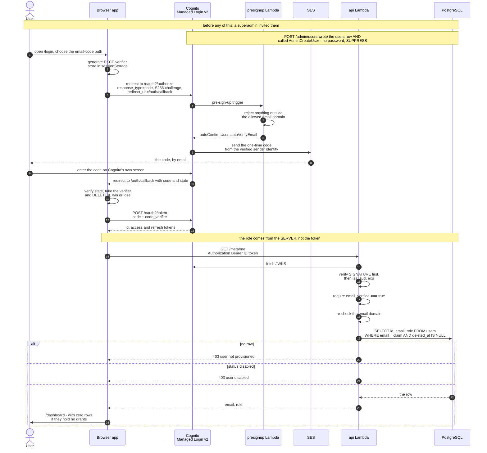
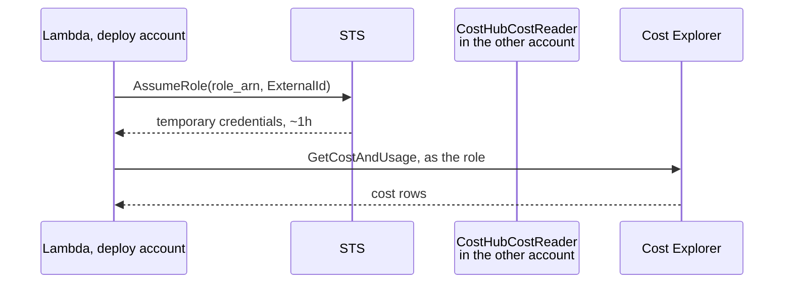

# Security and RBAC

Cost data is the sensitive asset here. Everything below exists to make one
claim defensible: **a user sees exactly the accounts and services they were
granted, and nothing else.**

---

## The model

A grant is a row:

```
(user, provider, account, service?, valid_from, valid_until?)
```

| Shape | Meaning |
|---|---|
| `service_name = NULL` | all services in that account |
| `valid_until = NULL` | indefinite |
| `revoked_at NOT NULL` | revoked — never matches, never deleted |

That is the whole RBAC. Two roles only (`superadmin`, `user`); no role
table, no permission matrix, no policy engine.

### Why no policy library

Casbin, OpenFGA and similar are good at "may this user call this
endpoint". They cannot filter **rows** unless their policy is translated
into SQL — which is the code we would be writing anyway. Importing one
would mean two authorisation systems, and the one that matters would not be
in the query path.

---

## The enforcement point

One module, one predicate, applied to every fact read.

```sql
EXISTS (
  SELECT 1
  FROM access_grants g
  WHERE g.user_id      = %(user_id)s
    AND g.revoked_at  IS NULL
    AND g.deleted_at  IS NULL
    AND g.provider     = f.provider
    AND g.account_id   = f.account_id
    AND (g.service_name IS NULL OR g.service_name = f.service_name)
    AND now() >= g.valid_from
    AND (g.valid_until IS NULL OR now() < g.valid_until)
)
```

`backend/costhub/query/scoped.py` is the only module that queries
`fact_cost_daily`, and `_where()` always injects **one of two things**: the
predicate above for an ordinary user, or the literal `TRUE` for a
superadmin — in which case it also writes an audit row carrying the scope
that was read.

That precision matters. "It always injects `GRANT_PREDICATE`" is the useful
shorthand, and the superadmin branch is the half worth being exact about:
there *is* a bypass, it is one named constant, and the control on it is the
audit row rather than the predicate.

Nothing else — not the API, not the alert evaluator, not the anomaly
scanner, not the insights builder — touches the fact table directly.

### This is enforced mechanically, not asserted

`backend/tests/test_invariant.py` walks the AST of every module in the
package. It fails the build when:

| Check | Fires on |
|---|---|
| single reader | a SQL literal selecting from `fact_cost_daily` in any module outside `{query/scoped.py, ingest/runner.py}` — the second writes, which is a different concern |
| predicate coverage | `scoped.py` having more `FROM fact_cost_daily f` than `_where(principal, f…)` calls |
| no fabricated superadmins | any module outside `scoped.py` constructing `Principal(role="superadmin")`, which replaces the predicate wholesale |
| file size | any module over 300 lines, except a reasoned exemption |

Each check has a companion test proving the check can actually fail — a
detector that cannot fire proves nothing. The string matching deliberately
excludes docstrings and comments, because matching raw source gave a false
positive the moment a docstring explained the rule it was documenting.

The invariant had already silently become false twice:
`anomaly/runner.py` and `cli.py` both grew direct reads while five
documents asserted it held. Asserting it in prose did not hold; asserting
it in a test does.

### Four properties this gives us

| Property | How |
|---|---|
| **Fails closed** | no grants → `EXISTS` matches nothing → zero rows |
| **Instant revocation** | `now()` evaluated per query; nothing cached |
| **Enforced in the database** | unauthorised rows never leave Postgres |
| **Reviewable** | it is nine lines of SQL in one place |

### The superadmin bypass, and where it is recorded

In `query/scoped._note_bypass`, called from `_where` at the point the
predicate is actually replaced, carrying the scope that was read.

It used to be logged at **authentication** time instead, in `api/deps.py`,
and that was wrong in two ways at once. It recorded "a superadmin signed
in" — true of a superadmin who only ever opened the settings page — and it
recorded no scope at all, so the audit trail could not answer the one
question it exists for: *which accounts did they look at.*

Throttled per `(actor, scope)` per hour, so a dashboard refresh does not
bury the log while reading a **different** account still shows up. Two
exclusions, both reasoned:

- The **system principal** is excluded. Background jobs are supposed to see
  everything, and they log once per run; a row per detector query would be
  noise rather than evidence.
- **`visible_services` passes `audit_bypass=False`.** It returns service
  names and no figures, but the audit entry says
  `entity_type='fact_cost_daily'` with the scope read — i.e. it claims a
  superadmin looked at cost data. The grant dialog calls it every time the
  operator changes the account in a dropdown, so clicking through ten
  accounts manufactured ten bypass records before anyone had been granted
  anything, and the audit screen headlines that count as evidence. An audit
  log that overstates is as hard to trust as one that understates. The
  grant predicate is still applied; only the note is suppressed.

An audit write failure never fails a read — but it is logged loudly,
because a silent gap here is the whole problem.

### If Superset is ever used as the UI

The same predicate goes in as a **Base** RLS filter excluding only Admin —
**not** a Regular filter. Superset's Regular filters apply only to listed
roles, so a user in no listed role gets **no filter and sees everything**.
That distinction is the single most likely way this design would leak if
ported to Superset.

---

## Signing in



Four things this diagram is deliberately explicit about.

**The domain is checked twice** — in the pre-sign-up trigger and again at
the API boundary, on the token's `email` claim. Either alone is a single
point of failure.

**`/meta/me` is the first real authenticated request.** A token the API
will not accept therefore fails at sign-in rather than later on the
dashboard. And the role is read from the `users` table, because a Cognito
ID token carries identity and knows nothing about this application's roles.

**PKCE even though the client has no secret.** A public client cannot
authenticate itself to the token endpoint, so the code alone bears the
grant; S256 PKCE binds it to this browser, which is what stops a code
leaked from history or a referer header being redeemed elsewhere. The
verifier is deleted the moment it is used, **including on failure**, so a
stale verifier cannot make the next attempt fail in a way that looks like a
Cognito problem.

**Reaching `/dashboard` is not access.** A newly invited user with no
grants sees an empty state, and that is the designed outcome.

### There are two sign-in paths, and the default is the other one

The frontend's default `/login` form posts **email and password** straight
to Cognito `InitiateAuth` with `USER_PASSWORD_AUTH`, so the form is ours
and the user never leaves. The OTP hand-off above is reached deliberately,
at `/login?otp=1`, or automatically when Cognito bounces an authorize
request back with an `error`.

> **Unresolved contradiction.** Nothing in the backend ever sets a Cognito
> password. `rbac/pool.create_user` calls `AdminCreateUser` with no
> `TemporaryPassword`, and `aws_cognito_user.superadmin` sets none either —
> both relying on a passwordless first-auth factor being active, which is
> what makes the omission mean "passwordless, CONFIRMED" rather than
> "generate a temporary one". So every invited user is created without a
> password, the password form is the default path for people who have none,
> and `/login?otp=1` is the path that can complete. This is a
> code-versus-code disagreement between the frontend and the pool writes,
> not a documentation gap. Recorded rather than papered over; somebody has
> to decide which path is the product.

### Who can actually log in

Four gates, and an address in the allowed domain clears only one of them.

| Gate | Enforced by |
|---|---|
| Must be **invited** | `allow_admin_create_user_only = true` — there is no self-signup surface at all |
| Must be in the **allowed domain** | `normalize_email`, the Cognito pre-sign-up trigger, **and** the API's claim check |
| Must be able to **receive the code** | SES delivers only to verified addresses while in sandbox, so each recipient is verified individually |
| Must have a **grant** to see anything | the grant predicate — signing in successfully and seeing zero rows is the designed outcome, not a failure |

The last one is worth repeating: **logging in is not access.**

| Property | Choice | Why |
|---|---|---|
| Registration | **none** — invite only | no self-signup surface |
| Credential | email OTP, passwordless | nothing to store, reset, leak or migrate |
| Tier | Cognito **ESSENTIALS** | required for passwordless; free to 10k MAU |
| UI | **Managed Login v2** | the classic Hosted UI cannot do passwordless |
| Domain limit | `allowed_email_domain` | pre-signup Lambda **and** API re-check |

### The pool configuration that is load-bearing

`sign_in_policy.allowed_first_auth_factors` is `["EMAIL_OTP", "PASSWORD"]`,
and **both entries are required** — for opposite reasons.

`EMAIL_OTP` must be listed because `AdminCreateUser` with no
`TemporaryPassword` only lands on `CONFIRMED` when a passwordless option is
active; for a pool with none, Cognito generates a temporary password and the
user lands in `FORCE_CHANGE_PASSWORD`, a state an OTP client has no screen
to clear. That would lock the Terraform-seeded superadmin out of a
deployment that reported success.

`PASSWORD` must be listed because Cognito **rejects the list without it**:

```
InvalidParameterException: Password should be configured as one of the
allowed first auth factors.
```

This was briefly `["EMAIL_OTP"]` alone, on the theory that including
`PASSWORD` made the pool password-capable and would push the seeded
superadmin into `FORCE_CHANGE_PASSWORD`. That was wrong twice over: the
list is invalid without it, and `AdminCreateUser` does not generate a
password when a passwordless factor is active.

### `write_attributes` is deliberately not `[]`

It read like a control and was not one. AWS exempts a pool's **required**
attributes from `write_attributes`, and `email` is `required = true` in the
schema — so the empty list was either silently ignored or an apply error.

The actual defence against a user rewriting their email to a superadmin's
address is in the API, below.

### `email_verified` is checked strictly

Cognito's `email` attribute is mutable, and a token carries
`aws.cognito.signin.user.admin` under `ALLOW_USER_AUTH` — so a user who can
change their own email can set it to a known superadmin's address,
re-authenticate and inherit the role. Changing it flips `email_verified` to
false, which is the signal to reject on.

**Absence is rejected, not accepted.** The first version only enforced the
claim where it was present, reasoning that an access token does not carry
it and that absence is not falsity. The second half is true and the
conclusion was still wrong: the attack is carried out with whatever token
the attacker can obtain, and one lacking the claim went straight through
the lenient branch. A missing claim means *unproven*, and unproven is what
this has to refuse.

There is also **no fallback to `username` or `cognito:username`**. The pool
is `username_attributes = ["email"]`, so for a real user those claims hold
the email — which is exactly what made the fallback look free. They carry
no verification status at all, so accepting one sourced the identity from a
field that `email_verified` says nothing about. A token with no `email`
claim is a token this app cannot authenticate, and saying so is the safe
answer.

### JWT verification — the step not to skip

`api/deps.py:_verify` must, in this order:

1. verify the **signature** against the pool's JWKS
2. verify issuer, audience and expiry, with `require: [exp, iss, aud]`
3. then, in `_email_from`, require `email_verified`
4. then check the domain, load the user, reject soft-deleted and `disabled`

Decoding a token without verifying its signature is the classic failure
here, and it is an open finding in the DFIQ RBAC audit. `verify_aud` is
also **always** true: making it conditional on a configured client id meant
an empty `COGNITO_CLIENT_ID` silently downgraded verification with no
visible signal.

### The dev-auth bypass needs three conditions

`X-Dev-User` is accepted only when `allow_dev_auth` **and** `app_env ==
"dev"` **and** no Cognito pool is configured. The first is the one that
matters: Terraform never sets it, so no deployed environment can reach the
bypass however the others drift.

The earlier two-condition version was not the defence it looked like.
`app_env` defaulted to `"dev"` and Terraform sets `APP_ENV` to the
workspace name, so a deployed `dev` environment satisfied one condition
permanently — leaving only the pool id between a public endpoint and a full
superadmin bypass. `app_env` now defaults to `"prod"`. `GET /health`
reports which auth mode is active, and the app logs a warning on startup
when the bypass is reachable.

### The risk passwordless introduces

Login depends on email delivery. Slow mail or a spam folder means nobody
can sign in, including stakeholders mid-demo.

**SES is mandatory, not a choice.** Cognito's built-in sender does not
support the email-OTP factor, so SES configuration is a prerequisite of
passwordless sign-in alongside the ESSENTIALS feature plan.

The sender identity matters too: a consumer address fails DMARC alignment,
because that domain's SPF does not authorise SES and DKIM signs as
`amazonses.com`. Microsoft 365 and Google Workspace recipients junk or
reject it, and the symptom is "nobody can log in" with no error anywhere.
Prefer a domain you control, and test delivery to a real inbox on day one.
Details in [11-configuration.md](11-configuration.md).

### Identity linking

```
users(id, email UNIQUE)            <- grants point here
identities(provider, subject, user_id)
```

Keying grants on `users.id` rather than the IdP subject means adding a
provider later is an insert into `identities`, not a migration of every
grant. For Microsoft OAuth, restrict by **tenant id, not email domain
string** — domain matching is the weaker check — and verify
`email_verified`.

### Removing a user: disable, not delete

`rbac/pool.disable_user` disables the pool user rather than deleting it,
and the choice is deliberate:

- It mirrors what the database does. `users` is soft-deleted so `audit_log`
  rows naming that user still resolve. A hard-deleted pool user leaves the
  other half of the same identity gone, and re-inviting the person mints a
  **new** Cognito `sub` — which `identities.subject` stores, so a delete
  orphans those rows while a disable keeps the pairing intact.
- It is reversible by the invite path, which is the only way a removed
  person comes back. `create_user` re-enables on `UsernameExistsException`
   — without that, removing someone and inviting them back gave them a
  revived `users` row and a pool user still disabled: an invite that cannot
  work.
- It is sufficient. Cognito refuses both authentication and token refresh
  for a disabled user.

**The app does not depend on that call to deny access**, which is worth
knowing before trusting it. `api/deps._load_user` requires `deleted_at IS
NULL`, so a removed user is refused by every endpoint the moment the row is
stamped — even with a still-valid token, and even if the Cognito call
failed. What the disable prevents is the narrower thing: someone removed
from the product still receiving login codes and reaching a signed-in shell
with nothing in it.

`AdminDeleteUser` is deliberately **absent** from the IAM policy.

---

## Cross-account access

The app is deployed in **one** account and reads others. The default and
recommended mode is a role:



The role in the other account:

- carries **only** cost read actions — and only two are ever used,
  `ce:GetCostAndUsage` and `ce:GetDimensionValues`
- trusts our account, gated by an **ExternalId**
- is revocable by deleting one role
- is created by hand by whoever holds IAM there, deliberately outside our
  Terraform, because we do not own that account and it must survive our
  teardown
- must sit at the **root IAM path**, named exactly `CostHubCostReader` —
  our own policy grants that ARN shape, so a role created under a path is
  denied by *us*, before their trust policy is consulted

**For an AssumeRole connection no long-lived credential exists anywhere**
(FR-12), which is why it is the default.

Each account also needs, from its **root user**, "IAM User and Role Access
to Billing Information" enabled, plus Cost Explorer switched on. Without
the first, every cost API returns `AccessDenied` regardless of policy. The
two-stage probe exists to tell these failures apart — see
[17-connection-lifecycle.md](17-connection-lifecycle.md).

### The fallback, and the limits on it

The role cannot always be had: registering an account needs IAM access *in*
it, and the common case is somebody who already holds a read-only key and
has nobody to create a role for them. Their only other option was
`credential_mode = 'profile'`, which **cannot run in Lambda at all** — so
that account's data moved only when a human ran the ingest from the one
machine with that profile.

`credential_mode = 'secret'` is the implemented alternative. It does
involve a long-lived credential, and these are the limits on it:

- it is entered once, in the browser, and **POSTed once**. The API writes it
  to Secrets Manager under
  `costhub/<env>/connections/<provider>-<account_id>` and stores only the
  resulting ARN in `cloud_connections.secret_arn`
- it is **never** written to Postgres, never put in an audit row — the trail
  records `secret_set: true`, the same treatment `external_id_set` already
  had — and **never returned by any endpoint**, including the 422 body,
  which `api/main.py` redacts because pydantic otherwise echoes the input
  back
- `secret_access_key` is a pydantic `SecretStr`, so nothing that `repr()`s
  the request model — a log line, a traceback, a validation error — can
  print it
- the Lambda role's write grant is scoped to that one name prefix
  (`terraform/iam.tf`, `ManageConnectionCredentials`), never `*`, and
  deliberately does not reach the database password one segment above it.
  The same shape is enforced again in `key_store.owned`, so neither control
  is the only thing standing between a delete and the wrong secret
- removing the connection, or switching it to another credential mode,
  **deletes the secret** — forced rather than scheduled, so re-registering
  cannot collide with a name still inside a recovery window

**Prefer the role where you can get one.** A static key is long-lived and
somebody has to look after it; this is the mode for an account where nobody
will create a role.

---

## Audit

Two layers, often conflated:

| Layer | Answers |
|---|---|
| Audit **columns** on a table | who last touched this row |
| Audit **log**, append-only | what changed, before and after, by whom |

Only access-affecting changes go to the log: grants, users, connections,
superadmin bypasses — plus one row per detection run and per ingest.

### Two properties that matter

**Same transaction.** `audit.log()` takes a cursor, not a connection, so
the entry commits or rolls back with the change it describes. An audit log
that can disagree with the data is worse than none.

**Append-only by statement trigger**, not convention — and not by grants,
which was asserted here for a long time and never existed:

```sql
-- migration 005: BEFORE UPDATE/DELETE statement triggers that RAISE.
-- The accompanying REVOKE is belt-and-braces only: Postgres grants
-- nothing to PUBLIC by default, and the app connects as the table owner,
-- which keeps implicit rights regardless. The triggers are the control.
CREATE TRIGGER audit_log_no_update BEFORE UPDATE ON audit_log
  FOR EACH STATEMENT EXECUTE FUNCTION audit_log_is_append_only();
```

`TRUNCATE` is **not** covered — the test suite truncates `audit_log`
between tests, which is the proof. A production role should not hold
TRUNCATE on it.

Revoked and expired grants are retained and flagged, never deleted, because
"why could X see account Y in March" is a real question with a real answer.

---

## Threat notes

| Concern | Mitigation | Status |
|---|---|---|
| Unauthorised cost visibility | one SQL predicate, fails closed | done |
| A second reader appearing later | AST check in `test_invariant.py`, with a test that it can fail | **done** |
| A module minting its own superadmin | AST check in `test_invariant.py` | **done** |
| Stale permission after revocation | evaluated per query, nothing cached | done |
| Alert leaking a revoked scope | grants re-checked **before** evaluation (FR-34) | done |
| Credential theft from the UI | the only credential input is the write-only `secret` key pair | done |
| A credential echoed in a 422 | `api/main.py` scrubs both fields from validation errors | **done** |
| Long-lived cross-account keys | `AssumeRole` + ExternalId is the default; `secret` is scoped to one Secrets Manager prefix | done, with a stated trade |
| Forged or unverified JWT | signature verified against JWKS before any claim; `require: [exp, iss, aud]` | done |
| Email-rewrite privilege escalation | `email_verified` required to be exactly true; absence rejected; no username fallback | done |
| Dev-auth bypass in a deployed env | three conditions, one of which Terraform never sets | done |
| SQL injection via grouping | `DIMENSIONS` / `GRAINS` allowlists; everything else bound | done |
| Audit tampering | statement triggers on `audit_log` | done; `TRUNCATE` still uncovered |
| An unhandled 500 reported as a CORS fault | `_UnhandledErrors` registered **inside** `CORSMiddleware` | done |
| Unauthenticated API access | API Gateway is public; the Cognito JWT is the control | by design |
| Public database endpoint | TLS enforced, generated password, open security group | **deferred**, TODO-1 and TODO-2 |
| No WAF | API Gateway throttling only — 20 burst, 50/s | **deferred**, TODO-6 |
| Over-broad `ce:` grant on our own role | 8 actions granted, 2 used | **open**, TODO-5 |
| Frontend no longer behind basic auth | `enable_basic_auth = false` on the Amplify branch | deliberate |

The deferred ones are real and knowingly accepted. They are listed in
[10-todo-future.md](10-todo-future.md) rather than left implicit — "we knew
and deferred" is a different statement from "we missed it", and only the
first survives review.

**On the Amplify basic auth being off.** It only ever covered the
Amplify-hosted *frontend*; the API behind it is a public API Gateway
endpoint guarded by the Cognito JWT, not by that password. So turning it
off widens who can load the page, not who can read data: an
unauthenticated visitor still gets the sign-in screen and every `/admin`
route still answers 401. To put it back, set `enable_basic_auth = true` and
restore `basic_auth_credentials` from the variables, which are still
declared.

---

## Demo checks

Run these in front of the audience; they are the proof, not the claim.

1. Superadmin → every connected account in the dropdown.
2. Restricted analyst → one account, narrowed services. Same build, same
   URL.
3. Brand-new user, no grants → empty state. Not an error, not everything.
4. Revoke a grant, refresh → the data is gone.
5. Admin → Audit shows all four, with actor, scope and timestamp.
