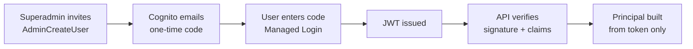
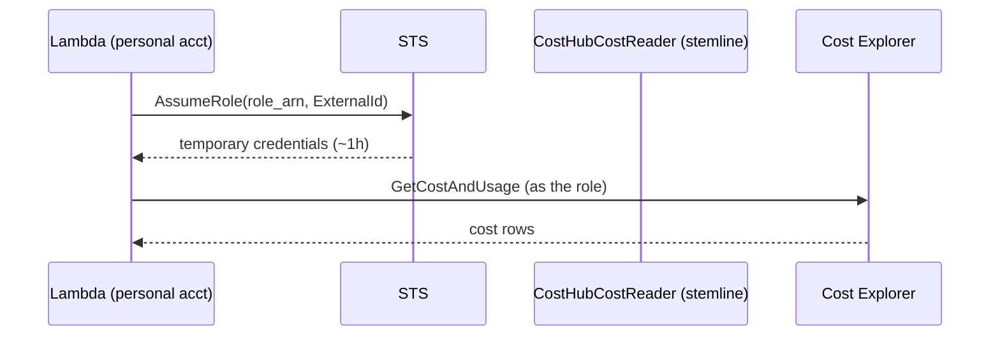

# Security and RBAC

Cost data is the sensitive asset here. Everything below exists to make one
claim defensible: **a user sees exactly the accounts and services they were
granted, and nothing else.**

---

## The model

A grant is a row:

```
(user, provider, account, service?, valid_from, valid_until?)
```

| Shape | Meaning |
|---|---|
| `service_name = NULL` | all services in that account |
| `valid_until = NULL` | indefinite |
| `revoked_at NOT NULL` | revoked — never matches, never deleted |

That is the whole RBAC. Two roles only (`superadmin`, `user`); no role table,
no permission matrix, no policy engine.

### Why no policy library

Casbin, OpenFGA and similar are good at "may this user call this endpoint".
They cannot filter **rows** unless their policy is translated into SQL —
which is the code we would be writing anyway. Importing one would mean two
authorization systems, and the one that matters would not be in the query
path.

---

## The enforcement point

One module, one predicate, applied to every fact read.

```sql
EXISTS (
  SELECT 1
  FROM access_grants g
  WHERE g.user_id      = %(user_id)s
    AND g.revoked_at  IS NULL
    AND g.deleted_at  IS NULL
    AND g.provider     = f.provider
    AND g.account_id   = f.account_id
    AND (g.service_name IS NULL OR g.service_name = f.service_name)
    AND now() >= g.valid_from
    AND (g.valid_until IS NULL OR now() < g.valid_until)
)
```

`costhub/query/scoped.py` is the only module that queries
`fact_cost_daily`, and `_where()` always injects this. Nothing else — not the
API, not the alert evaluator, not the anomaly scanner — touches the fact
table directly.

### Four properties this gives us

| Property | How |
|---|---|
| **Fails closed** | no grants → `EXISTS` matches nothing → zero rows |
| **Instant revocation** | `now()` evaluated per query; nothing cached |
| **Enforced in the database** | unauthorized rows never leave Postgres |
| **Reviewable** | it is nine lines of SQL in one place |

### Superadmin bypass

The predicate is replaced with `TRUE`, and the bypass is recorded in
`audit_log`. An unlogged bypass is indistinguishable from a leak, so logging
it is not optional.

### If Superset is ever used as the UI

The same predicate goes in as a **Base** RLS filter excluding only Admin —
**not** a Regular filter. Superset's Regular filters apply only to listed
roles, so a user in no listed role gets **no filter and sees everything**.
That distinction is the single most likely way this design would leak if
ported to Superset.

---

## Authentication



The first box is two writes, and for a while it was only one.
`rbac.invite_user` wrote the `users` row and stopped; nothing in the
codebase called `AdminCreateUser`. The docstring described the diagram
above rather than what the function did, so an invited teammate got a
database row, Cognito had never heard of them, and no code could ever be
sent. The only pool user was the superadmin, created declaratively by
`aws_cognito_user` in Terraform — which is why it was never noticed.

`rbac/pool.py` is the missing half. Both writes happen in one
transaction: a pool failure rolls the `users` row back, so a failed
invite leaves nothing behind and can be retried as-is. The IAM policy
had granted `cognito-idp:AdminCreateUser` the whole time, under a
statement named `ManageInvitedUsers`.

### Who can actually log in

Four gates, and a chryselys.com address clears only one of them:

| Gate | Enforced by |
|---|---|
| Must be **invited** | `allow_admin_create_user_only = true` — there is no self-signup surface at all |
| Must be **@chryselys.com** | `normalize_email`, *and* the Cognito pre-sign-up trigger |
| Must be able to **receive the code** | SES sandbox delivers only to verified addresses, so each recipient is verified individually |
| Must have a **grant** to see anything | the grant predicate — signing in successfully and seeing zero rows is the designed outcome, not a failure |

The last one is the point worth repeating: **logging in is not access.**
A newly invited user with no grants sees an empty state, and
`test_no_grants_sees_nothing` is the first test in the suite.

| Property | Choice | Why |
|---|---|---|
| Registration | **none** — invite only | no self-signup surface |
| Credential | email OTP (passwordless) | nothing to store, reset, leak or migrate |
| Tier | Cognito **Essentials** | required for passwordless; free to 10k MAU |
| UI | **Managed Login** | classic Hosted UI does not support passwordless |
| Domain limit | `@chryselys.com` | pre-signup Lambda **and** API re-check |

### There is no password, at any point

Not set at creation, not after first sign-in. `AdminCreateUser` is called
with **no** `TemporaryPassword`, which — because the pool offers
**`EMAIL_OTP` only** — puts the user straight into `CONFIRMED` state
rather than `FORCE_CHANGE_PASSWORD`, and sends no temporary-password
email. Every required pool attribute must be supplied in that call or it
fails.

That "only" is load-bearing, and it was wrong until review caught it.
`sign_in_policy.allowed_first_auth_factors` was `["EMAIL_OTP",
"PASSWORD"]` — which makes the pool password-*capable*, so
`AdminCreateUser` with no password generates one and the user lands in
`FORCE_CHANGE_PASSWORD`: a state an OTP-only client has no screen to
clear. The seeded superadmin would have been locked out of a deployment
that reported success. Listing `PASSWORD` "just in case" is what breaks
passwordless.

Every sign-in is then: email → fresh single-use code → tokens. The OTP is
**per session, not per request**; the refresh token lifetime governs how
often a code is needed (shorten it for the demo so the flow is visible).

Three consequences:

- no register screen, no forgot-password screen, no reset flow
- no credential store to breach
- nothing to migrate between accounts — users are recreated from our own
  `users` table

**The risk this introduces:** login now depends on email delivery. Slow mail
or a spam folder means nobody can sign in, including stakeholders mid-demo.

**SES is mandatory, not a choice.** Cognito's built-in sender does not
support the email-OTP factor — SES configuration is a prerequisite of
passwordless sign-in, alongside the Essentials feature plan.

And the sender identity matters: a consumer address (`@gmail.com`) fails
DMARC alignment, because that domain's SPF does not authorise SES and DKIM
signs as `amazonses.com`. Microsoft 365 and Google Workspace recipients junk
or reject it, and the symptom is "nobody can log in" with no error anywhere.
Prefer a domain you control, and test delivery to a real `@chryselys.com`
inbox on day one. Details in [11-configuration.md](11-configuration.md).

### Domain restriction in two places

The Cognito pre-signup Lambda rejects non-Chryselys addresses, and the API
re-checks the email claim. Either alone is a single point of failure; the
account already has a working example of the Lambda pattern
(`dfiq-cognito-presignup`).

For Microsoft OAuth later, restrict by **tenant ID, not email domain string**
— domain matching is the weaker check — and verify `email_verified`.

One source, not four. The domain lives in `config.Settings`
(`allowed_email_domain`) and every check reads it from there. It was
hardcoded in `rbac/admin.py` as well, so changing the environment moved
three checks and silently left that one behind — which in a different
tenant means invitations rejected with a message naming somebody else's
domain.

### `email_verified` is checked strictly

Cognito's `email` attribute is mutable, and a token carries
`aws.cognito.signin.user.admin` under `ALLOW_USER_AUTH` — so a user who
can change their own email can set it to a known superadmin's address,
re-authenticate and inherit the role. Changing it flips `email_verified`
to false, which is the signal to reject on.

**Absence is rejected, not accepted.** The first version only enforced
the claim where it was present, reasoning that an access token does not
carry it and that absence is not falsity. The second half is true and
the conclusion was still wrong: the attack is carried out with whatever
token the attacker can obtain, and one lacking the claim went straight
through the lenient branch. A missing claim means *unproven*, and
unproven is what this has to refuse.

There is also no fallback to `username` or `cognito:username`. The pool
is `username_attributes = ["email"]`, so for a real user those claims
hold the email — which is exactly what made the fallback look free.
They carry no verification status at all, so accepting one sourced the
identity from a field `email_verified` says nothing about.

### Identity linking

```
users(id, email UNIQUE)            <- grants point here
identities(provider, subject, user_id)
```

Cognito password login and Microsoft OAuth on the same email produce **two
distinct identities** unless linked. Keying grants on `users.id` rather than
the IdP subject means adding a provider is an insert, not a migration of
every grant.

### JWT verification — the step not to skip

`api/deps.py` must:

1. verify the **signature** against Cognito's JWKS
2. verify issuer, audience, expiry
3. verify email domain
4. load the user; reject `disabled`

Decoding a token without verifying its signature is the classic failure, and
it is an open finding in the DFIQ RBAC audit. Do not inherit it.

---

## Cross-account access

The app is deployed in **one** account and reads others through a role.



The role in stemline:

- carries **only** cost read actions (`ce:Get*`), nothing else
- trusts our account, gated by an **External ID**
- is revocable by deleting one role
- is created by hand by whoever holds IAM there, and is deliberately outside
  our Terraform because we do not own that account

**No long-lived credential exists anywhere**, and no secret ever passes
through the frontend (FR-12). The alternative — an IAM user with an access
key — is documented as a fallback only.

Each account also needs, by its root user: **"IAM User and Role Access to
Billing Information"** enabled, and Cost Explorer switched on. Without the
first, every cost API returns `AccessDenied` regardless of policy.

---

## Audit

Two layers, often conflated:

| Layer | Answers |
|---|---|
| Audit **columns** on every table | who last touched this row |
| Audit **log**, append-only | what changed, before and after, by whom |

Only access-affecting changes go to the log: grants, users, connections,
superadmin bypasses.

### Two properties that matter

**Same transaction.** `audit.log()` takes a cursor, not a connection, so the
entry commits or rolls back with the change it describes. An audit log that
can disagree with the data is worse than none.

**Append-only by statement trigger**, not convention. Not by grant — that
was asserted here for a long time and never existed:

```sql
-- migration 005: BEFORE UPDATE/DELETE statement triggers that RAISE.
-- The accompanying REVOKE is belt-and-braces only: Postgres grants
-- nothing to PUBLIC by default, and the app connects as the table owner,
-- which keeps implicit rights regardless. The triggers are the control.
CREATE TRIGGER audit_log_no_update BEFORE UPDATE ON audit_log
  FOR EACH STATEMENT EXECUTE FUNCTION audit_log_is_append_only();
```

TRUNCATE is **not** covered — the test suite truncates `audit_log`
between tests, which is the proof. A production role should not hold
TRUNCATE on it.

Revoked and expired grants are retained and flagged, never deleted, because
"why could X see account Y in March" is a real question with a real answer.

---

## Threat notes

| Concern | Mitigation | Status |
|---|---|---|
| Unauthorized cost visibility | single SQL predicate, fails closed | done |
| Stale permission after revocation | evaluated per query, no cache | done |
| Alert leaking a revoked scope | grants re-checked **before** evaluation (FR-34) | **built** (`alerts/runner.py`) |
| Credential theft from the UI | no credential ever enters the UI | done |
| Long-lived cross-account keys | `AssumeRole` + External ID | **built** (`connections/credentials.py`) |
| Forged/unverified JWT | signature verified against JWKS before any claim; `require: [exp, iss, aud]` | **built** (`api/deps.py:_verify`) |
| SQL injection via grouping | `DIMENSIONS`/`GRAINS` allowlists | done |
| Audit tampering | statement triggers on `audit_log` (migration 005) | **built**; `TRUNCATE` still uncovered |
| Public database endpoint | TLS enforced, strong password | **deferred**, see TODO-1 |
| No API rate limiting | Function URL has none | **deferred**, see TODO-6 |

The last two are real and knowingly accepted for a 10-day internal demo.
They are listed in [10-todo-future.md](10-todo-future.md) rather than left
implicit — "we knew and deferred" is a different statement from "we missed
it", and only the first survives review.

---

## Demo checks

Run these in front of the audience; they are the proof, not the claim.

1. Superadmin → both accounts in the dropdown.
2. Restricted analyst → one account, two services. Same build, same URL.
3. Brand-new user, no grants → empty state. Not an error, not everything.
4. Revoke a grant, refresh → the data is gone.
5. Admin → Audit shows all four of the above, with actor and timestamp.
