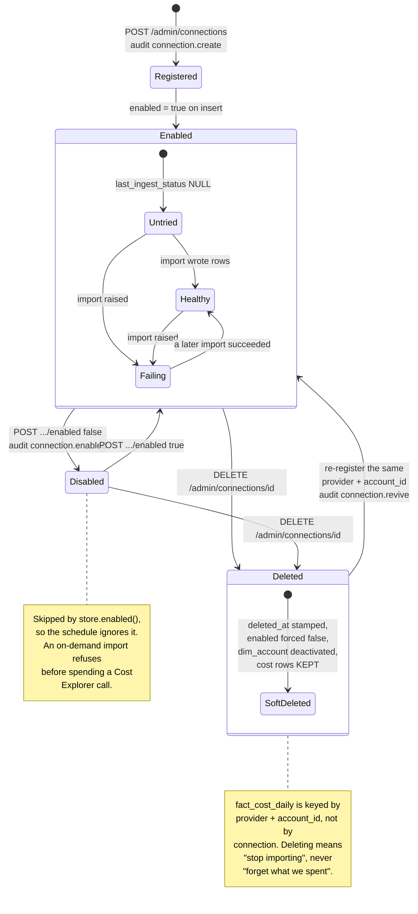
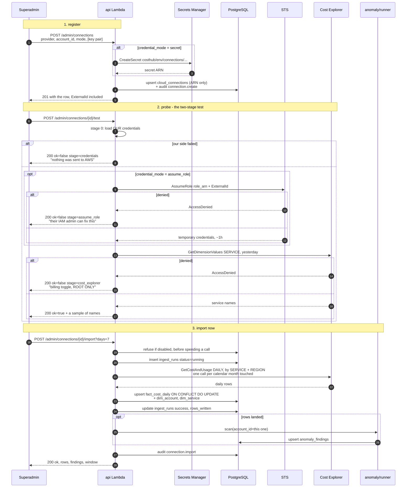

# A connection's life

One cloud account to read from is one row in `cloud_connections`. This page
is that row's whole life: how it gets credentials, what states it moves
through, how you find out which prerequisite is missing, and what happens
when it is removed.

The schema is in [03-data-model.md](03-data-model.md); the security argument
for the credential modes is in [07-security-rbac.md](07-security-rbac.md).

---

## The four credential modes

`credential_mode` is a `CHECK`-constrained column
(`migrations/004_connections.sql`) and is resolved by
`connections/credentials.py`. In decreasing order of preference:

| Mode | Used for | Where credentials come from | Runs in Lambda? |
|---|---|---|---|
| `self` | the deploy account itself | the Lambda's own execution role — nothing to hold | yes |
| `assume_role` | another AWS account | `sts:AssumeRole` with `role_arn` and `external_id`, credentials expire in an hour | yes |
| `profile` | local development only | a named AWS CLI profile on the developer's machine | **no** |
| `secret` | AWS fallback, and all of Azure | a long-lived credential in Secrets Manager, read at call time via `secret_arn` | yes |

### `profile` cannot work in Lambda, and that is not a configuration problem

A `profile` connection resolves a named profile from the AWS CLI
configuration on the machine running the code. There is no such file in a
Lambda execution environment, so the deployed API and the 06:00 ingest
answer `could not load profile '<name>'` — every time, permanently. Such an
account's data moves only when somebody runs the ingest by hand from the
machine that has the profile.

This is stated wherever the modes are listed because it is invisible in the
code path: `own_session` builds a session the same way for every mode, and
the failure arrives as an ordinary credential error rather than as "this
mode is unavailable here".

**The two fixes, in order of preference.** Create a `CostHubCostReader`
role in the target account and switch to `assume_role` — nothing long-lived
exists anywhere, and it is the default for that reason. Where nobody will
create a role, switch to `secret` and enter an access key: it is a
long-lived credential and somebody has to look after it, but it runs on the
schedule, which `profile` never will.

### What `secret` actually stores

Not the credential. The key pair is POSTed once, written to Secrets Manager
by the API (`connections/key_store.py`) under the deterministic name
`costhub/<env>/connections/<provider>-<account_id>`, and the row keeps only
the resulting ARN.

The two credential fields on `POST /admin/connections` —
`access_key_id` and `secret_access_key` — are inputs only. Neither is a
column. `secret_access_key` is a pydantic `SecretStr`, so nothing that
`repr()`s the request model can print it, and `api/main.py` installs a
`RequestValidationError` handler that blanks both fields out of a 422 body
(pydantic otherwise echoes the whole parent object back on a `missing`
error, credential included).

The Lambda role's write grant is scoped to that one name prefix —
`terraform/iam.tf`, statement `ManageConnectionCredentials` — and
deliberately does not reach the database password, which lives at
`costhub/<env>/database-url`, one segment short of the wildcard. The same
shape is enforced again in code (`key_store.owned`), so neither control is
the only thing standing between a delete and the wrong secret.

---

## States



### What each transition actually does

**Registered.** `store.upsert` is idempotent on `(provider, account_id)`,
so re-running it is safe. It audits under three different names depending
on what was in the slot: `connection.create` for a new row,
`connection.update` for a live one, `connection.revive` for a soft-deleted
one coming back. The prior row is read `FOR UPDATE` *before* the upsert,
because `RETURNING` sees the row as the upsert left it — with `deleted_at`
already cleared — which is how a revived row came to be logged as an
ordinary update, leaving nothing in the trail to say a deleted connection
had returned.

**Healthy / Failing** is not a column with those names. It is
`last_ingest_status`, stamped `'success'` or `'failed'` by
`store.record_ingest` at the end of each per-connection attempt
(`ingest/runner.py`). The connections screen reads it directly.

**Disabled** keeps the whole history (FR-13). It is skipped by
`store.enabled()`, so the schedule passes it over. The on-demand import
route checks `conn.enabled` *before* fetching, because `store.get` filters
on `deleted_at` only — without that guard a disabled account was imported,
billed for, and stamped `last_ingest_status='success'` while the screen
drew it greyed out as disabled.

**Soft-deleted.** `edits.soft_delete` stamps `deleted_at`, forces `enabled`
false, and deactivates the matching `dim_account` row so the account leaves
every dropdown while its cost history stays joinable. The row itself stays,
because `audit_log` entries naming it have to keep resolving. If the
connection was in `secret` mode the secret is deleted too — forced rather
than scheduled, so re-registering the same account cannot collide with a
name still inside a recovery window.

**Revived.** The unique key is `(provider, account_id)` and a soft-deleted
row still occupies it, so the upsert has to clear `deleted_at` and reset
`enabled` — without those two lines, re-registering an account answered 201
while leaving the row deleted: the UI showed success, the row stayed out of
`enabled()`, and nothing ever imported. A revived row also forgets
`last_ingest_at` and `last_ingest_status`, because to the person
registering it this is a new connection and "Last import: failed" from
months ago on something that has never run is a lie. An ordinary update
keeps its real history.

### The state that is briefly a lie

An `ingest_runs` row is committed as `running` **before** fetching, so a
crash leaves something visible rather than nothing. When the process is
killed mid-fetch — API Gateway cuts an on-demand import at 29s, the Lambda
at 30 — no cost rows are half-written, but nothing closes the run either.
`ingest/stale.py:reap_stale_runs` is what closes it, and it is called
before every ingest and before everything that displays these columns: the
two admin listings, and the CLI's `list-connections` and `status`.

It bounds the lie rather than removing it. For `STALE_RUN_MINUTES` after a
timeout the run still reads `running` and the connection still shows its
earlier result — which is also exactly what a slow run that is genuinely
alive looks like, and the two cannot be told apart sooner.

---

## Registering an account and importing from it



### Why the probe is two stages

`AssumeRole` and the cost call fail with the **same error code** —
`AccessDenied` — for completely different reasons, and conflating them
sends the other account's administrator to check the wrong thing.

| Stage that failed | What is actually wrong | Who can fix it |
|---|---|---|
| `credentials` | our own configuration: a profile that does not exist here, no credentials in the environment, a missing or unreadable secret, a malformed role ARN. **Nothing was sent to AWS.** | us |
| `assume_role` | the role does not exist, its trust policy does not name this account, or the ExternalId does not match | their IAM administrator |
| `cost_explorer` | the role was assumed, so trust is correct. Either the billing toggle is off or the role's policy lacks `ce:Get*` | their **root user**, for the toggle |

Stage 0 is deliberately outside the `AssumeRole` handler. A profile that
does not exist on this machine raises `ProfileNotFound`, which is a
`BotoCoreError` — so when it shared a try block with the STS call it was
reported as stage `assume_role`, "Could not reach AWS STS", for a failure
in which STS was never contacted and the other account's role had nothing
to do with it.

An **empty** service list from stage 2 is a **pass**, and saying so matters:
a new account, or one whose Cost Explorer was enabled in the last 24 hours,
is readable and simply has nothing yet — which looks identical to a failure
if the only thing reported is "no data".

Both `test` and `import` answer **200 with a verdict in the body** rather
than a 4xx, because "the request ran and the connection is broken" and "the
request failed" are different facts and the operator needs to tell them
apart.

### Why the import runs inline

Imports used to happen only on the 06:00 schedule, so registering an
account — or fixing a role — told you nothing until the next morning, and
"I just connected it, show me" is the obvious next click.

It does not invoke the ingest Lambda, for two reasons. That function has no
notion of a single connection: it loops over `store.enabled()`, so
triggering it would import every account to answer a question about one.
And an asynchronous invoke returns nothing useful — the caller would poll
`/admin/ingest-runs` and the immediate verdict, which is the entire point,
would be gone.

The time budget is real: API Gateway cuts the request at 29s and the Lambda
dies at 30. `days <= 31` bounds the fetch at one Cost Explorer call per
calendar month touched — 31 days always touches two and sometimes three —
which at a measured ~3.4s a call is roughly 10s, and the detection pass
adds its own few seconds on top and grows with the estate.

---

## What the target account must have

Three prerequisites, and the IAM role is only one of them. Two are
root-only or one-time account settings, which is why a perfect role can
still read nothing.

| # | Prerequisite | Who | Note |
|---|---|---|---|
| 1 | Role `CostHubCostReader`, **at the root IAM path** | their IAM admin | trust policy names our account, gated by the ExternalId |
| 2 | "IAM User and Role Access to Billing Information" enabled | **root only** | without it every cost API returns `AccessDenied` however perfect the policy |
| 3 | Cost Explorer enabled | billing access | free, enabled once, up to 24 hours to populate |

**Only two Cost Explorer permissions are ever used.** Verified against the
code: `ce:GetDimensionValues` (`connections/probe.py`, the probe's stage-2
call) and `ce:GetCostAndUsage` (`ingest/cost_explorer.py`, the only fetch).
Nothing in `backend/costhub/` calls any other `ce:` operation.

```json
{ "Effect": "Allow",
  "Action": ["ce:GetCostAndUsage", "ce:GetDimensionValues"],
  "Resource": "*" }
```

```json
{ "Effect": "Allow",
  "Principal": { "AWS": "arn:aws:iam::<DEPLOY_ACCOUNT_ID>:root" },
  "Action": "sts:AssumeRole",
  "Condition": { "StringEquals": { "sts:ExternalId": "<EXTERNAL_ID>" } } }
```

Cost Explorer has no resource-level permissions, so `"Resource": "*"` is
the only valid value. `AWSBillingReadOnlyAccess` is the managed-policy
alternative — far broader than two actions, but sometimes an easier
approval.

> **Our own deploy role is broader than this, and should be narrowed.**
> `terraform/iam.tf` grants eight `ce:` actions to the Lambda role:
> `GetCostAndUsage`, `GetCostForecast`, `GetDimensionValues`, `GetTags`,
> `GetAnomalies`, `GetAnomalyMonitors`, `GetAnomalySubscriptions` and
> `ListCostAllocationTags`. Six of those have no caller. They are
> read-only and harmless, but they are not least privilege, and the role
> is shared by all five functions. Narrowing it is a Terraform change, not
> a documentation one — TODO-5.

### The role must sit at the root IAM path

Our own policy grants `arn:aws:iam::*:role/CostHubCostReader` — exactly
that name, at the root path. A role created under a path has the ARN
`...:role/<path>/CostHubCostReader`, which is a perfectly valid ARN, so STS
evaluates it and answers `AccessDenied` — and it is **our** policy doing
the denying, before their trust policy is ever consulted. The probe detects
this case (`probe._off_root_path`) and says so, because the generic message
sends the other administrator to fix a trust policy that is fine.

---

## The ExternalId is returned, not redacted

`GET /admin/connections` returns `external_id` in full, and that is a
reversal of an earlier decision to show the literal string `"set"`.

An ExternalId is not a password. Its purpose is the confused-deputy
problem, and it works by being unguessable by **third parties** — it is
shared, by design, between exactly the two people who need it: the owner of
this deployment and the administrator of the target account. The whole
workflow is "generate it, send it to them, they put it in their trust
policy".

Redacting it from a superadmin removed the one value they have to
distribute, with no way to read it back, so a typo meant deleting the
connection and starting again. It was incoherent as well, because
`role_arn` — the other half of the same trust — was returned in full to the
same caller on the same row. What protects it is that the route is
superadmin-only and the value is a UUID.

---

## Where Azure differs

Same port and no schema change: `provider='azure'`, `account_id` holds the
subscription or billing-account id, and the columns are already
FOCUS-aligned.

| Concern | Detail |
|---|---|
| Credential mode | always `secret`. Azure has no cross-cloud equivalent of `AssumeRole`, so a long-lived client secret is unavoidable |
| What the secret holds | `tenant_id`, `client_id`, `client_secret` — an Entra app registration |
| Role needed | **Cost Management Reader** at subscription or billing-account scope |
| Probing | **not implemented.** `probe()` returns `stage="unsupported"` for any non-AWS provider and says plainly that it cannot be verified from here |
| Live state | never run against Azure. `tests/test_azure_cm.py` covers parsing and transport through a mock HTTP client, so the request shape and pagination are real; the live path is not |
